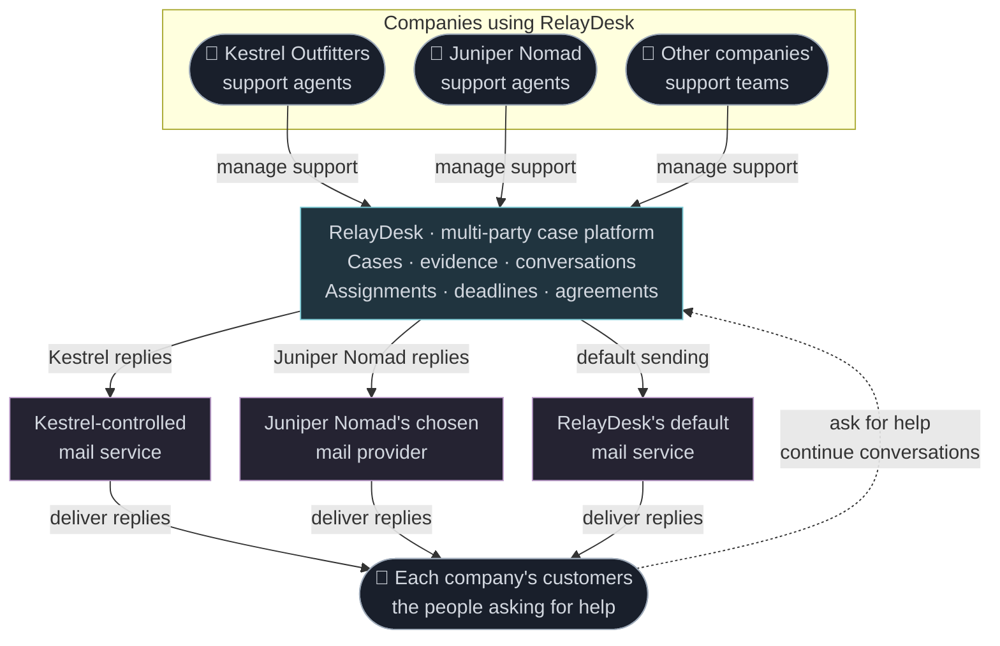
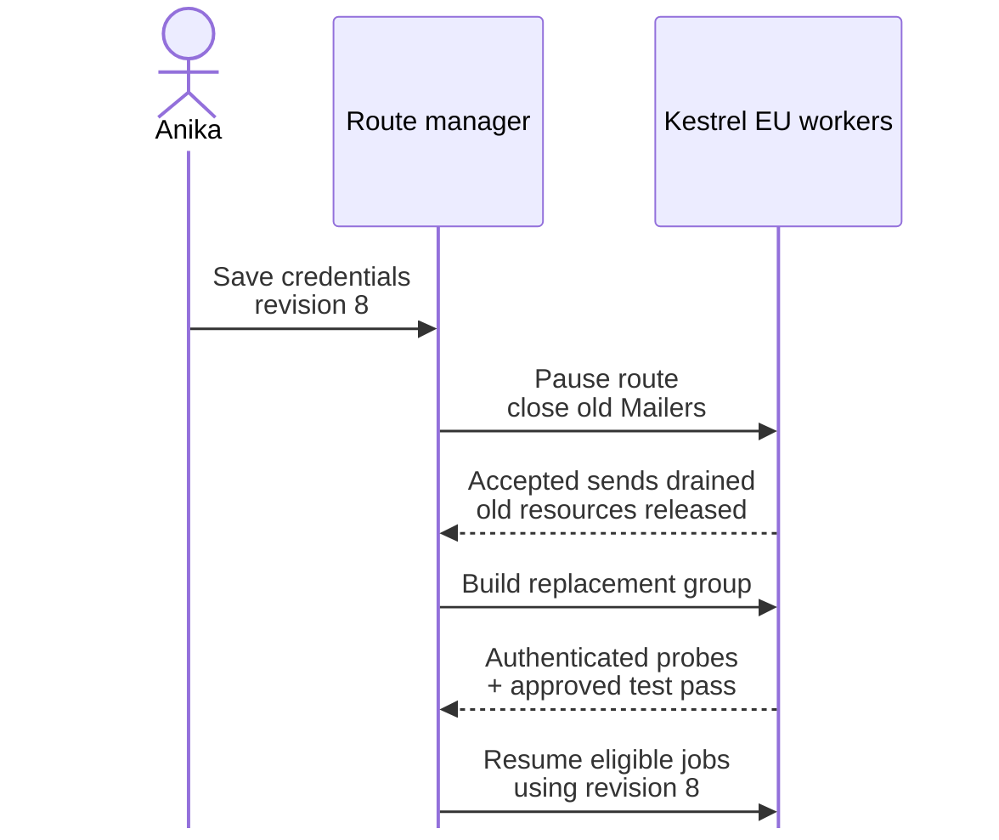

Between the corporate towers and street-level businesses, a team of runners enter a grimy bar. It's their usual spot for winding down after a run. In the corner sits an orc, preoccupied with his pad, scrolling. A repair gig catches his eye. He accepts. The half-orc waitress sets down his beer, but he is already getting up, waving his cred stick. He puts the pad inside his worn brown leather jacket, eyes the group of runners for a second and heads out, leaving the beer untouched. Outside, he climbs into a Juniper Nomad air taxi and takes off.

There are two reasons why Sam might leave his beer for a job. One is a good gig from a fixer, the other is an incident at RelayDesk.

## Centralized support, decentralized mail servers

RelayDesk is old and trusted. Nobody knows who operates it. Some say an AI; others call it a relic from the before time. It has survived and become the backbone of many a fixer and information broker.

It keeps multi-party cases together: participants, evidence, assignments, deadlines and a record of what everybody agreed to. Businesses use it for support and deliveries; fixers and brokers coordinate jobs and information requests. Each party chooses its approved communication channels, including its own mail service.

And it uses Simple Java Mail, which apparently stood the test of time. In another timeline, RelayDesk was a perfectly respectable customer-support SaaS. Then Sam became an orc, and things escalated.

<!-- Editable Mermaid source for the infographic below. Template contents do not display or run. -->
<template id="relaydesk-support-network-source" data-pagefind-ignore>



</template>

[](/assets/journal/articles/relaydesk/relaydesk-support-network.jpg)

*Customer support is one use of RelayDesk; each company's replies leave through its approved mail service.*

Kestrel Outfitters sells drones, spare parts and field equipment for riggers and is one of RelayDesk's customers. Its support agents work in RelayDesk, but their replies go out as Kestrel Support. Most tenants use RelayDesk's default sending service. A fixer brokered Kestrel's deal with RelayDesk, but Kestrel supplied the mail settings and one firm condition: replies go through its own SMTP servers, where it already manages domain signing and mail policies.

## Maya has the answer, but the customer hears nothing

<div class="journal-persona-block journal-persona-intro">
<header class="journal-persona-header"><strong>Maya</strong><span>AI case coordinator · Kestrel workspace</span><span class="journal-persona-stats">[+2 Investigation · +1 Diplomacy · −1 Sysadmin]</span></header>

<a href="/assets/journal/articles/relaydesk/personas/relay-desk-maya.jpg"></a>

*Maya has found the spider-bot. Her customer is still waiting for the answer.*

<div class="journal-persona-copy">

Maya handles Kestrel's routine support cases inside RelayDesk. She's an AI case coordinator; the woman in the portrait is her avatar. Kestrel lets her inspect its support records and send replies, but its mail settings remain Kestrel's responsibility. We'll see *Anika* taking care of that later.

A shopper wants to know where their **Logicoma MKII** spider-bot has gone. Maya finds it waiting at a collection point and submits the directions through Kestrel's approved mail service, but the message gets stuck: Kestrel rotated an SMTP password on Friday afternoon, and RelayDesk is still using the old one. RelayDesk posts an integration-repair gig, the job that drew Sam out of the bar. RelayDesk always pays well.

</div>
</div>

<div class="journal-persona-block journal-persona-intro journal-persona-intro--portrait-left">
<header class="journal-persona-header"><strong>Sam</strong><span>Solo runner · RelayDesk repair gig</span><span class="journal-persona-stats">[+2 Debugging · +1 Engineering · −1 Admin rights]</span></header>

<a href="/assets/journal/articles/relaydesk/personas/relay-desk-sam.jpg"></a>

*Sam's contract covers the sending integration, not Kestrel's mail administration.*

<div class="journal-persona-copy">

Sam, an orc solo runner, has picked up a gig repairing RelayDesk's Java mail integration. He needs replacement credentials from Anika, Kestrel's mail administrator, but cannot reach her until Monday. He can repair RelayDesk's integration, but other people's passwords are beyond his reach.

</div>
</div>

Let's give Sam a better answer than restarting the application and hoping. We'll use Simple Java Mail for the sending work, with customer permissions, job scheduling and configuration changes handled by RelayDesk's application.

## The setup

RelayDesk's Java backend runs in Europe and North America; solo runners such as Sam pick up its integration repair gigs. Kestrel operates in both regions, with a pair of equivalent relays in each. Maya's ticket comes from a European customer.

Juniper Nomad Air Services gives RelayDesk one SMTP address to send through; its mail provider manages the servers behind that address. Juniper's agents keep sending replies while Kestrel's mail is stuck. Here's a closer look at the sending code and the services it connects to:

```mermaid
%% journal: compact
%%{init: { "flowchart": { "curve": "stepAfter", "padding": 8, "wrappingWidth": 320, "nodeSpacing": 24, "rankSpacing": 32 } } }%%
%% journal-portrait-link: agentsToPortal agents source bottom
%% journal-portrait-link: samMaintenance sam source left
%% journal-portrait-link: kestrelAdmin anika target top
%% journal-image-inlet: storedJobs workers
flowchart TB
    accTitle: RelayDesk uses the sending service approved by each customer
    accDescr: Maya is an AI case coordinator authorized to save and send replies within Kestrel's workspace. Human case agents use the same platform. Sam, a solo runner, repairs the sending integration under contract; its regional dispatch workers use Simple Java Mail through approved mail services. Kestrel has separate European and North American relay pairs; Juniper has one managed endpoint. Anika administers Kestrel's relays. The diagram groups deployments logically, not into a cross-region pool.

    agents@{ shape: rect, label: "<span class='diagram-person diagram-person-hex'><span class='diagram-person-portrait'></span><span class='diagram-person-copy'><strong>Maya</strong><span>Kestrel AI coordinator</span></span></span>" }
    subgraph relaydesk["RelayDesk · multi-party case platform"]
        portal@{ img: "/assets/journal/articles/relaydesk/nodes/relaydesk-cyberpunk-support-conversations-node.png", label: "Case conversations", h: 85, pos: "b", constraint: "on" }
        store@{ img: "/assets/journal/articles/relaydesk/nodes/relaydesk-cyberpunk-database-node.png", label: "Saved replies<br/>+ send attempts", h: 85, pos: "b", constraint: "on" }
        workers@{ img: "/assets/journal/articles/relaydesk/nodes/relaydesk-cyberpunk-dispatch-workers-node.png", label: "Regional dispatch workers<br/>Simple Java Mail", h: 150, pos: "b", constraint: "on" }
        portal --> store
        store storedJobs@--> workers
    end
    agents agentsToPortal@--> portal
    sam@{ shape: rect, label: "<span class='diagram-person diagram-person-hex'><span class='diagram-person-portrait'></span><span class='diagram-person-copy'><strong>Sam</strong><span>Solo runner</span></span></span>" }
    sam samMaintenance@-.->|handles this update gig| workers

    defaultMail@{ img: "/assets/journal/articles/relaydesk/nodes/relaydesk-cyberpunk-default-smtp-node.png", label: "RelayDesk default<br/>sending service", h: 85, pos: "b", constraint: "on" }
    kestrel@{ img: "/assets/journal/articles/relaydesk/nodes/relaydesk-cyberpunk-kestrel-smtp-node.png", label: "Kestrel Outfitters<br/>EU relay pair · US relay pair<br/>separate regional groups", h: 85, pos: "b", constraint: "on" }
    juniper@{ img: "/assets/journal/articles/relaydesk/nodes/relaydesk-cyberpunk-juniper-smtp-node.png", label: "Juniper Nomad<br/>managed SMTP endpoint", h: 85, pos: "b", constraint: "on" }
    workers ---> defaultMail
    workers ---> kestrel
    workers ---> juniper
    anika@{ shape: rect, label: "<span class='diagram-person diagram-person-hex'><span class='diagram-person-portrait'></span><span class='diagram-person-copy'><strong>Anika</strong><span>Kestrel mail administrator</span></span></span>" }
    kestrel kestrelAdmin@-.->|administered by| anika
    agentsToPortal@{ curve: basis }
    samMaintenance@{ curve: basis }
    kestrelAdmin@{ curve: basis }

    classDef person fill:none,stroke:none,color:#BECBD0
    classDef component fill:none,stroke:none,color:#E4E9EE
    classDef storage fill:none,stroke:none,color:#E4E9EE
    classDef external fill:none,stroke:none,color:#E4E9EE
    class agents,sam,anika person
    class portal,workers component
    class store storage
    class defaultMail,kestrel,juniper external
```

*Maya submits an authorized reply; Kestrel decides which mail servers deliver it.*

RelayDesk runs each customer's dispatch workers in the agreed regions, with each deployment maintaining its own connection pools.

Unlike the two developers at [Staple & Sons](/case-studies/staple-and-sons.html), Sam cannot reconfigure his customers' mail servers. Nor does he have [Polar Meridian's](/case-studies/polar-meridian.html) dedicated corporate messaging team to agree a common enterprise service with. Instead, he gets a contact address, a configuration form and occasionally a spreadsheet; he gets to point the tenant's outgoing mail at the customer's chosen servers, and that's mostly it. "Work work" and "Job's done!" is more his thing, good little peon that he is.

## Sam checks a customer's SMTP settings before sending replies

<div class="journal-persona-block journal-persona-intro">
<header class="journal-persona-header"><strong>Anika</strong><span>Mail administrator · Kestrel Outfitters</span><span class="journal-persona-stats">[+2 Sysadmin · +1 Security · −1 Weekend availability]</span></header>

<a href="/assets/journal/articles/relaydesk/personas/relay-desk-anika.jpg"></a>

*Anika decides how RelayDesk may use Kestrel's mail servers.*

<div class="journal-persona-copy">

When Kestrel first onboarded, Anika supplied the approved SMTP settings through RelayDesk's configuration form, together with the permitted connections, sending rate and any daily quota. She also specified whether each limit applied per relay, account or source IP, so RelayDesk could choose its own operating settings without exceeding Kestrel's limits.

</div>
</div>

Before customer replies start flowing, Sam checks:

- **Does the connection check out?** Sam verifies that TLS and [server-identity checks](/security.html#section-verify-server-identity) succeed using the agreed certificate-trust configuration.
- **Do the credentials work?** An [authenticated probe](/debugging.html#section-smtp-capabilities) tests the account without sending a customer reply.
- **May the account send these replies?** A controlled test email uses the agreed sender and return addresses, with bounce handling checked too.

Kestrel's relays already handle [DKIM](/case-studies/staple-and-sons.html#spf-dkim-and-dmarc); Anika confirms the SPF and DMARC setup too.

Kestrel's wholesale partners already use [OpenPGP](/security.html#section-sending-openpgp) to exchange commercial attachments, so RelayDesk has to sign and encrypt those replies. A shopper waiting for their spider-bot, though, should be able to read Maya's directions without installing PGP software.

## Maya's reply cannot borrow Juniper's connection

With the servers approved, RelayDesk needs to choose the right one for each reply. Here, a **route** means the customer's permitted region, SMTP endpoint or interchangeable endpoints, and approved SMTP settings. RelayDesk chooses the route from the authenticated customer account and saved conversation, keeping Maya’s reply on Kestrel’s European relays.

For our two customers, the choices are:

| Reply belongs to | Eligible SMTP connections |
| --- | --- |
| Kestrel's European operation, including Maya's ticket | Kestrel EU relay 1 or EU relay 2 |
| Kestrel's North American operation | Kestrel US relay 1 or US relay 2 |
| Juniper Nomad | Juniper's managed endpoint |

Each row gets its own [SJM cluster key](/sending-and-execution.html#section-clustering). Mailers sharing a key can use connections from one another's pools. Kestrel allows either European relay to send Maya’s reply, so they can share a cluster key; its US relays and Juniper’s server need their own keys. Sender permissions, credentials and TLS requirements all matter here; speaking SMTP is not enough to make two servers interchangeable.

The keys are application-managed identifiers, loaded from RelayDesk's approved configuration. Sam also chooses connection, worker and waiting-queue limits within Anika's allocation. `recipientsPerPeriod` and `sendingRatePeriod` describe this backend instance's share of the customer's sending rate; `sendingRateGroup`, such as `"kestrel-eu"`, lets its two Mailers share that local limit:

```java
Mailer kestrelEu1 = createMailer(mail, kestrelEuKey,
    "smtp-eu-1.kestrel-outfitters.com", username, password,
    maxConnectionsPerRelay, asyncWorkersPerMailer, waitingOperationsPerMailer,
    sendingRateGroup, recipientsPerPeriod, sendingRatePeriod,
    observer, observerWorkers);
Mailer kestrelEu2 = createMailer(mail, kestrelEuKey,
    "smtp-eu-2.kestrel-outfitters.com", username, password,
    maxConnectionsPerRelay, asyncWorkersPerMailer, waitingOperationsPerMailer,
    sendingRateGroup, recipientsPerPeriod, sendingRatePeriod,
    observer, observerWorkers);
```

*Kestrel's European relays can share the work.*

`createMailer(...)` is a small application helper, shown below. `mail` is a `SimpleJavaMail` factory using an approved configuration snapshot; the credentials come from secret storage. Both relay members are built before the route accepts work. The same key in another JVM does **not** create a distributed pool, nor does a UUID enforce data residency.

For Juniper, one reusable `Mailer` is enough because its provider manages the servers behind the hostname. Kestrel, on the other hand, gives RelayDesk two interchangeable relays per region, which is where SJM’s clustering becomes useful.

### Mailer connection limits and RelayDesk dispatcher capacity

RelayDesk controls capacity at two levels. Each reusable Mailer bounds the connections and local work for one active customer route, while the Dispatcher coordinates the limits shared by that customer's Mailers.

#### Size the Mailer's connections and workers

Kestrel's limits tell Sam what RelayDesk may use, not what it needs to use. He chooses `maxConnectionsPerRelay` within that allocation, accounting for every RelayDesk deployment connecting to Kestrel. Attachment-heavy replies also need memory and processing time before SMTP starts, so he sizes `asyncWorkersPerMailer` for RelayDesk's available resources and measured workload rather than simply matching the connection count. With the backlog safely in the database, `waitingOperationsPerMailer` only needs to absorb short bursts within an acceptable local waiting time.

[](/assets/journal/articles/relaydesk/relaydesk-connection-capacity.png)

*In this illustrative route profile, four connections per relay meet measured demand. Sam selects six for headroom, still below RelayDesk's own ceiling and the share Kestrel allows this deployment.*

Here's how those application settings reach SJM, with the [batch module](/modules.html#batch-module) installed. The factory carries shared message settings and compatible connection requirements; customer-specific hosts and credentials enter through the arguments below. They must agree with any explicit imported connection declarations. The unreleased 10.0.0 line's default [connection conflict policy](/configuration.html#connection-conflicts) stops construction if an old deployment value names a different route:

```java code-small
static Mailer createMailer(SimpleJavaMail mail, UUID clusterKey,
        String smtpHost, String username, String password,
        int maxConnectionsPerRelay, int asyncWorkersPerMailer,
        int waitingOperationsPerMailer,
        String sendingRateGroup, int recipientsPerPeriod, Duration sendingRatePeriod,
        MailSendResultObserver observer, Executor observerWorkers) {
    return mail.mailerBuilder()
        .withSMTPServer(smtpHost, 587, username, password)
        .withTransportStrategy(TransportStrategy.SMTP_TLS)
        .withTlsConfig(TlsConfig.builder()
            .trustingAllHosts(false)
            .trustingSSLHosts() // clear any host-specific trust exceptions
            .verifyingServerIdentity(true)
            .build())
        .withConnectionPoolConfig(ConnectionPoolConfig.builder()
            .withClusterKey(clusterKey)
            .withCoreSize(0) // no need to stay connected while quiet
            .withMaxSize(maxConnectionsPerRelay) // within Kestrel's connection allocation
            .withExpireAfter(Duration.ofSeconds(30)) // retire idle connections
            .withClaimTimeout(Duration.ofSeconds(2)) // don't wait forever for a pool
            .build())
        .withMailSendTimeout(Duration.ofSeconds(20)) // bound each send attempt
        .withAsyncExecutionConfig(AsyncExecutionConfig.builder()
            .withThreadPoolSize(asyncWorkersPerMailer) // operations executing, including preparation
            .withQueueCapacity(waitingOperationsPerMailer) // waiting in memory, not the durable backlog
            .rejectWhenFull() // refuse work when workers and queue are full
            .build())
        .withSendingLimitsConfig(SendingLimitsConfig.builder()
            .withRecipientRateLimit(recipientsPerPeriod, sendingRatePeriod) // this instance's share of Kestrel's rate
            .withRateLimitGroup(sendingRateGroup) // both approved relays share the local limit
            .withRateLimitBurstsAllowed(false) // pace the backlog after recovery
            .build())
        .withSendHandlers(MailSendHandlers.builder().withResultObserver(observer, observerWorkers).build())
        .buildMailer();
}
```

*Quiet customers release idle connections; busy customers still have limits.*

#### Coordinate shared capacity in the Dispatcher

Some customers send all day, while others answer only a few tickets a week. RelayDesk therefore keeps Mailers ready for active customer routes, limits how many routes each Dispatcher instance holds at once and lets quiet connections close when idle.

When Sam sizes this route, he budgets RelayDesk's local workers and in-memory queue slots across the two Mailers serving Kestrel's European relay pair. The Mailers share an SJM [sending limit](/sending-and-execution.html#section-sending-limits), while RelayDesk's dispatcher keeps Kestrel's combined traffic within its overall rate and daily quota and prevents one busy customer from monopolizing the service.

[Polar Meridian's Dispatcher](/case-studies/polar-meridian.html#getting-mail-jobs-to-share-not-compete) shows this application layer in more detail. It leaves the durable backlog in a database, divides shared capacity among traffic classes and only hands work to SJM when it is ready to run. RelayDesk applies the same pattern across customer routes instead.

#### Probe the route before accepting replies

Before admitting work, Sam tests each approved endpoint with an [authenticated probe](/debugging.html#section-smtp-capabilities):

```java
SmtpConnectionReport report = mailer.sync().probeConnection(/*authenticate*/ true);

if (!report.isSuccessful()) {
    throw new IllegalStateException("SMTP credential check did not pass: " + report);
}
```

*Test Kestrel's credentials without submitting a support reply.*

With the password Kestrel rotated on Friday still configured, an illustrative report could look like this:

```text code-small code-compact
SMTP connection probe: FAILED
Endpoint: smtp-eu-1.kestrel-outfitters.com:587 (smtp)
Greeting: 220 smtp-eu-1.kestrel-outfitters.com ready
Before TLS: {SIZE=[26214400], STARTTLS=[]}
STARTTLS: completed
After TLS: {AUTH=[LOGIN PLAIN], DSN=[], SIZE=[26214400]}
TLS active during setup: true
TLS details: TLSv1.3, cipher=TLS_AES_256_GCM_SHA384, peer=[CN=smtp-eu-1.kestrel-outfitters.com, smtp-eu-1.kestrel-outfitters.com], configured identity check=true, custom hostname verifier=not observed
Authentication: not completed (LOGIN)
Failure at AUTHENTICATION: Authentication did not complete. Check the credentials or token provider and the server's advertised AUTH mechanisms.
Elapsed: 164ms
```

*The connection and TLS setup succeeded; Kestrel rejected the stale credentials before any reply was submitted.*

The probe uses a dedicated connection, outside the pool. It sends no message and doesn't replace the controlled test email.

Beyond checking the credentials, Sam sends a standard batch of test emails when onboarding a customer's servers, covering compatibility and policy checks like the following:

| Test message | What Sam checks |
| --- | --- |
| A large attachment | Rehearsal shows encoded size; the actual send checks the relay's advertised SIZE limit. Missing size information means unknown, not unlimited. |
| A recipient such as `josé@partner.com` | The mailbox needs SMTPUTF8. An accented display name or MIME-encoded subject alone doesn't. Raw eight-bit content may separately need 8BITMIME. |

SJM checks the capabilities on the actual sending connection. A missing required capability stops submission; Sam doesn't enable [legacy compatibility](/configuration.html#section-legacy-smtp-content) across all customers to make the warning disappear.

#### Retire a route by closing its Mailers

Idle connection expiry only releases unused SMTP connections; it does not retire the reusable `Mailer`. When RelayDesk removes a customer route, its Dispatcher stops assigning new jobs to that route across every backend instance, leaving unscheduled replies in the database. Each instance then calls [`Mailer.close()`](/sending-and-execution.html#section-mailer-lifecycle) on every Mailer belonging to the route. SJM rejects further submissions to those Mailers, drains the work they already accepted and finally releases their executors and connection-pool registrations. RelayDesk coordinates the route; SJM shuts down each Mailer gracefully. The same automated lifecycle handles an approved credential replacement.

### Protect Kestrel's wholesale replies

With Kestrel's Mailers configured, Sam can prepare its wholesale replies for the partners who require OpenPGP. `wholesaleReply` is the `Email` containing their commercial attachments; `keys` is RelayDesk's tenant-specific key directory. With `openpgp-module` installed, the helper uses `kestrelEu1` to resolve the message's actual recipients before looking up their approved keys:

```java code-small
String customerId = "kestrel";

MailRehearsal rehearsal = kestrelEu1.rehearse(wholesaleReply, false);
Email effectiveReply = rehearsal.getEffectiveEmail(); // includes defaults and overrides

OpenPgpEncryptionConfigBuilder encryption = OpenPgpEncryptionConfig.builder();
for (String address : rehearsal.getEnvelopeRecipients()) {
    encryption.addRecipientPublicKeyRing(
        keys.requireRecipientKey(customerId, address));
}

EmailPopulatingBuilder protectedReplyBuilder = mail.emailBuilder()
    .copying(effectiveReply);
protectedReplyBuilder
    .withTemplateOptions(protectedReplyBuilder.getTemplateOptions().toBuilder()
        .ignoringDefaults()
        .ignoringOverrides() // don't apply them again after key selection
        .build())
    .signWithOpenPgp(keys.requireSigningConfig(customerId))
    .encryptWithOpenPgp(encryption.build());
Email protectedReply = protectedReplyBuilder.buildEmail();
```

*Look up each partner's approved key under Kestrel's account, not somebody else's.*

RelayDesk checks each key against the approved partner before using it; when a key is missing, the reply waits instead of being sent unencrypted. The rehearsal resolves the recipients first, and the protected send takes care of signing and encryption afterward. The outgoing message is protected, but securing RelayDesk's stored conversations and attachments remains the application's responsibility and is beyond this article's scope.

RelayDesk follows Kestrel's partners' established OpenPGP workflow. For a certificate-based alternative, see how [Polar Meridian uses S/MIME](/case-studies/polar-meridian.html#one-protected-message-several-partners) for its protected maintenance updates.

## Juniper's replies still need to leave

Kestrel's broken European credentials shouldn't stop its US operation or Juniper's support desk. Nor should a slow Kestrel relay occupy every worker while Juniper's perfectly usable connection sits idle. Separate cluster keys stop the wrong connection being selected, but they don't decide who gets a worker or how fast work comes in.

### The Dispatcher gives each customer a turn

RelayDesk's dispatcher regularly checks the database for waiting replies and gives each customer a turn when their concurrency and sending-rate limits permit. It only hands a job to Simple Java Mail when the job can run; until then, the reply stays safely in the database:

```mermaid
%% journal: compact
%%{init: { "flowchart": { "padding": 8, "wrappingWidth": 320, "nodeSpacing": 32, "rankSpacing": 40 } } }%%
%% journal-image-branch: dispatchKestrelUs dispatcher kestrelUs
%% journal-image-branch: dispatchKestrel dispatcher kestrel center
%% journal-image-branch: dispatchJuniper dispatcher juniper
%% journal-image-branch: savedReplies store dispatcher center
flowchart LR
    accTitle: A blocked customer does not occupy the whole dispatcher
    accDescr: Saved replies wait in durable storage. RelayDesk's dispatcher checks customer limits before submitting work. Kestrel's paused European route leaves its replies in storage, while its US route and Juniper keep sending through their own Mailers. This logical view brings separate regional deployments together; it does not create a worldwide connection pool. Simple Java Mail's connection pools do not implement this scheduling policy.

    %% Reserve the same caption height as the dispatcher to align the artwork centers.
    store@{ img: "/assets/journal/articles/relaydesk/nodes/relaydesk-cyberpunk-database-node.png", label: "Saved replies<br/>&nbsp;", h: 85, pos: "b", constraint: "on" }
    dispatcher@{ img: "/assets/journal/articles/relaydesk/nodes/relaydesk-cyberpunk-dispatch-workers-node.png", label: "RelayDesk dispatcher<br/>customer turn + available capacity", h: 150, pos: "b", constraint: "on" }
    kestrelUs@{ img: "/assets/journal/articles/relaydesk/nodes/relaydesk-cyberpunk-kestrel-smtp-us-node.png", label: "Kestrel US · ready<br/>submit through its Mailers", h: 85, pos: "b", constraint: "on" }
    kestrel@{ img: "/assets/journal/articles/relaydesk/nodes/relaydesk-cyberpunk-kestrel-smtp-eu-node.png", label: "Kestrel EU · route paused<br/>keep jobs in storage", h: 85, pos: "b", constraint: "on" }
    juniper@{ img: "/assets/journal/articles/relaydesk/nodes/relaydesk-cyberpunk-juniper-smtp-node.png", label: "Juniper · ready<br/>submit through its Mailer", h: 85, pos: "b", constraint: "on" }
    store savedReplies@--> dispatcher
    dispatcher dispatchKestrelUs@---> kestrelUs
    dispatcher dispatchKestrel@---> kestrel
    dispatcher dispatchJuniper@---> juniper
    classDef waiting fill:none,stroke:none,color:#EBA680
    classDef ready fill:none,stroke:none,color:#A4E7B1
    classDef storage fill:none,stroke:none,color:#E4E9EE
    class kestrel waiting
    class kestrelUs,juniper ready
    class store,dispatcher storage
    linkStyle 1,3 stroke:#A4E7B1
    linkStyle 2 stroke:#EBA680
```

*Kestrel EU waits for its administrator. Kestrel US and Juniper keep sending.*

### Full queues return work to the Dispatcher

If a Mailer's workers and local waiting queue are full, Simple Java Mail [rejects the new attempt](/sending-and-execution.html#section-async-queue) before it starts. The dispatcher can then release the capacity it set aside for that job and leave the reply in the database for a later turn, rather than repeatedly trying or making the calling thread send it. With other failures, it must check whether SMTP accepted the message before trying again.

A worker waiting for an SMTP connection isn't available to another job, so the [claim timeout](/sending-and-execution.html#section-reusing-connections) keeps it from waiting indefinitely. The [send deadline](/sending-and-execution.html#section-send-deadlines) goes further, limiting the whole attempt with the managed SMTP transport used here. These settings keep work from getting stuck; deciding whose turn comes next still belongs to RelayDesk's dispatcher, which accounts for the customer's Mailers across every backend instance.

The earlier [`withRecipientRateLimit(recipientsPerPeriod, sendingRatePeriod)`](/sending-and-execution.html#section-sending-limits) and [`withRateLimitBurstsAllowed(false)`](/sending-and-execution.html#section-sending-limits) settings earn their place when Kestrel recovers. Together, they make SJM space out the waiting replies according to how many recipient deliveries they represent: a reply to ten recipients uses ten times as much of Kestrel's permitted rate as a reply to one. Anika doesn't need recovery from one outage to cause the next.

[Polar Meridian's failover rehearsal](/case-studies/polar-meridian.html#noor-takes-a-relay-offline-does-urgent-mail-keep-moving) handles an unreachable relay. Kestrel's rejected password is different: authentication-failure failover is off by default, and another Mailer with the same stale credentials wouldn't help. Juniper's working server remains out of bounds.

## What happened to Maya's reply?

Before RelayDesk retries the waiting jobs, Sam needs to know what happened to the attempts already made. Retrying a definite authentication failure is one thing; retrying a reply the relay might have accepted could make Maya send the same answer twice.

### Tie every result to its sending attempt

Alongside the saved conversation, reply and attachments, RelayDesk records each sending attempt before handing it to Simple Java Mail. That record ties the Message-ID to the customer, ticket, route and saved version of the SMTP settings used, so Sam can trace a failure even after the settings change. The [completion observer](/sending-and-execution.html#section-mail-send-observer) adds the result to the same record:

```java
MailSendResultObserver observer = outcome ->
    attemptResults.record(outcome.getInitialMessageId(), outcome);
```

*Attach the result to Maya's ticket and the SMTP settings used for that attempt.*

The application helper `attemptResults` writes the result to RelayDesk's database, using the fixed initial Message-ID to find the attempt even if the transport reports another ID. Sam also gets the stages' timestamps in `MailSendOutcome`, although this callback doesn't report status changes as they happen.

Once the Dispatcher has capacity for Maya's job and has saved its attempt record, it resolves the route stored on that attempt to an active Mailer. For this job, that means Kestrel's European relay group:

```java
Mailer tenantMailer = routeMailers.requireFor(savedAttempt.getRoute());
// kestrelEu1

MailSend<MailSubmissionReceipt> send =
    tenantMailer.async().sendMail(reply);
```

*Submit Maya's reply through Kestrel; the configured observer records how the attempt finished.*

`MailSend` is SJM's asynchronous send handle. Its `getCompletion()` lets a caller await the result; the observer above also captures failed attempts, including those that never produce a submission receipt.

### Give Maya a result she can act on

With the attempt result saved, Maya can follow up without guessing. Kestrel's human staff can inspect the same evidence in the ticket:

| Evidence in RelayDesk | Case status |
| --- | --- |
| Saved reply, no attempt admitted yet | Waiting to send |
| Authentication failed before submission | Sending paused; your mail administrator has been notified |
| Receipt confirms SMTP acceptance | Submitted to your mail service |
| Partial or unknown acceptance | Needs investigation; no automatic resend of the whole reply |
| A later, validated delivery failure report | Bounced after submission |

RelayDesk translates SJM's results into these case statuses for Maya and Kestrel's authorized staff. Its `ticket` helper can also show staff why an attachment was rejected, using the saved `MailSendOutcome outcome` without exposing passwords or protocol transcripts:

```java code-small
outcome.getSubmissionReceipt().ifPresent(receipt ->
    ticket.showMessageSize(receipt.getMessageSize(), receipt.getServerMaximumMessageSize()));

// ticket output:
// Message size
//  Encoded email:        12.0 MB
//  Kestrel relay limit:  10.0 MB
```

*The ticket can explain the oversized reply instead of reducing the result to “send failed.”*

### Retry the warehouse's copy, not the buyer's

Another support reply includes a buyer, a warehouse contact and a former colleague. Sam lets this message proceed for the recipients the relay accepts. `replyEmailBuilder` already contains the three recipients, content and approved sender, now let's configure it so it sends what it can:

```java
Email multiRecipientReply = replyEmailBuilder
    .withSmtpDeliveryOptions(replyEmailBuilder.getSmtpDeliveryOptions().toBuilder()
        .withSendingToAcceptedRecipients(true)
        .build())
    .buildEmail();
```

*Submit the accepted recipients' copies; retain the rejected recipients' results.*

This [per-email choice](/analyzing-send-results.html#section-partial-send) applies only to this reply; another message can require all recipients to be accepted before its content is submitted. The saved `outcome` can distinguish all three:

| Recipient | Submission result | Next step |
| --- | --- | --- |
| Buyer | Accepted after DATA | Don't resend this copy |
| Warehouse | Temporarily rejected at RCPT | Eligible for a later attempt |
| Former colleague | Permanently rejected at RCPT | Correct the contact details |

```java
outcome.getSubmissionReceipt().ifPresent(receipt -> {
    ticket.showRecipients(receipt.getRecipientResults());
    ticket.showRetryAdvice(
       receipt.getRetryDisposition(), receipt.getRetryableRecipients());
});
```

*The warehouse can be retried without sending the buyer another copy.*

Simple Java Mail identifies recipients who could be retried, while RelayDesk decides whether it may try again and how long to wait. If final acceptance is unknown, Sam needs to investigate instead; without partial sending, the recipient rejection would have prevented the buyer from receiving the reply as well.

The database write can fail too, so RelayDesk must surface failures from its limited `observerWorkers` pool and `attemptResults` helper. [Polar Meridian covers those failures](/case-studies/polar-meridian.html#when-the-archive-is-slower-than-smtp); if a crash leaves Sam without a result, he needs to investigate rather than automatically resend.

## Update Kestrel's settings without stopping Juniper

By Monday, Sam has confirmed a definite authentication failure for Maya's attempt, and Anika enters the approved replacement credentials in Kestrel's RelayDesk settings. Saving them creates configuration revision 8, but the [configuration factory](/configuration.html#section-config-snapshot) and existing Mailers keep the settings they were built with.

The saved revision therefore triggers RelayDesk's route manager, which replaces both affected European Mailers together. During the short pause, Maya can still save replies and Juniper keeps sending:



*Saving Kestrel's credentials replaces that route without stopping the others.*

### Saving the credentials starts the replacement

Saving revision 8 marks Kestrel EU as replacing. Every Dispatcher stops assigning new jobs to the route and leaves them in the database, while each backend instance's route manager calls [`Mailer.close()`](/sending-and-execution.html#section-mailer-lifecycle) on the old pair. Simple Java Mail rejects late submissions, drains accepted work and releases the old resources. That is appropriate for a routine password change; revoking credentials during a security incident might require different treatment of sends already in progress.

Using the same factory, cluster key, pool settings and local rate group, the route manager builds a new pair with the revision 8 credentials. It runs `probeConnection(true)` on each Mailer, followed by the controlled send test batch. If either replacement fails, the route stays paused and both new Mailers close rather than falling back to the old credentials. If both pass, the Dispatcher activates revision 8 and schedules a **new attempt**, linked to the same reply, for Maya’s confirmed authentication failure. Attempts with uncertain acceptance stay out of the automatic retry queue, so fixing the password cannot create a duplicate reply.

## Accepted by SMTP. Then a bounce arrives.

Maya's retried reply is accepted by Kestrel's relay. RelayDesk now shows “Submitted to your mail service”, and the shopper receives her answer. On the next ticket, though, a reply gets the same successful submission result and comes back five minutes later: **that recipient's mailbox no longer exists**.

The send observer has finished its job by then, because the bounce is a new incoming email sent to one of the return addresses Anika approved during onboarding. RelayDesk needs to attach ordinary replies to the conversation, but a delivery failure to the particular sending attempt.

### Give replies and bounces different return paths

Starting with the recipient, content and attachments already in the reply builder, RelayDesk adds Kestrel's approved return addresses. It uses stored, random UUID tokens to link incoming replies and reports to the conversation or attempt without putting customer details in those addresses:

```java
Email reply = replyEmailBuilder
    .withSmtpDeliveryOptions(replyEmailBuilder.getSmtpDeliveryOptions().toBuilder()
        .withSendingToAcceptedRecipients(true) // approved for this support reply
        .withDeliveryStatusNotification(
            DeliveryStatusNotification.ReturnOption.HEADERS_ONLY,
            DeliveryStatusNotification.NotifyOption.FAILURE,
            DeliveryStatusNotification.NotifyOption.DELAY)
        .fixingEnvelopeId(attemptToken.toString())
        .build())
    .fixingMessageId("<" + attemptToken + "@mail.relaydesk.com>")
    .from("Kestrel Support", "support@kestrel-outfitters.com")
    .withReplyTo("Kestrel Support",
        "ticket+" + conversationToken + "@replies.kestrel-outfitters.com")
    .withBounceTo("bounce+" + attemptToken + "@bounces.kestrel-outfitters.com")
    .buildEmail();
```

*Human replies return to the ticket; delivery reports identify the send attempt.*

Ordinary replies follow the `Reply-To` message header, whereas `withBounceTo(...)` sets the SMTP envelope sender, `MAIL FROM`, where failures normally return. For servers supporting DSN, the [delivery-status notification options](/features.html#section-delivery-status-notification) request failure and delay reports with headers rather than another copy of the attachments; the envelope ID gives RelayDesk another way to identify the attempt in a returned DSN. These are [delivery reports](https://www.rfc-editor.org/rfc/rfc3461.html#section-4), not read receipts or a promise that a report will arrive.

### Match the bounce to the sending attempt

Anika's onboarding test includes a real bounce, checking that the relay permits the envelope sender, domain authentication still works and any address rewriting leaves RelayDesk able to match the report to an attempt. A matching UUID helps find the record, but doesn't prove the incoming message is genuine.

Before updating the ticket, RelayDesk's incoming-mail handler checks the report against the stored customer, attempt and recipient. It avoids duplicate notifications if the same report arrives twice and won't resend to an invalid address, while keeping the original SMTP acceptance in the history alongside the later failure:

```text
Ticket KD-1043 · attempt 1
10:14  Submitted to Kestrel's mail service
10:19  Delivery failed: recipient mailbox does not exist
       Maya notified; reply not automatically resent
```

*Track record of a bounced email*

With the failure attached to the right ticket, Maya checks the customer's contact details. Kestrel confirms an updated address, and she sends the reply there as a new attempt, keeping the failed one in the history. There's nothing for Sam or Anika to repair this time, and no reason to keep retrying a mailbox that no longer exists.

If Maya wants confirmation that the customer has read her corrected reply, Simple Java Mail can request a [read receipt](/features.html#section-return-receipt) using `withDispositionNotificationTo(...)` or the provider-dependent `withReturnReceiptTo(...)`. The [recipient can ignore an MDN request](https://www.rfc-editor.org/rfc/rfc8098.html#section-2.1), though, so a missing receipt leaves the reply's read status unknown.

Some platforms turn to tracking pixels here: tiny remote images with a URL unique to the message, whose download is recorded as an apparent open. [Mail clients can block the image or fetch it in the background](https://support.apple.com/guide/mail/change-privacy-settings-mlhlae4a4fe6/mac), though, so even that doesn't prove the customer read the reply.

## RUN COMPLETE, JACK OUT

Maya's reply has reached the shopper, and Juniper's support desk has kept sending throughout Kestrel's password change.

Simple Java Mail handles the [connection reuse](/sending-and-execution.html#section-reusing-connections), [approved pool groups](/sending-and-execution.html#section-clustering), [protected submission](/security.html#section-transport-strategy-tls) and [send results](/analyzing-send-results.html#section-get-receipt), giving Sam the controls to contain a failing route even when he cannot repair the server behind it. One customer's problem never has to become every customer's problem.

---

The next fixer can bring another customer, and another contract for Sam. Or maybe Kestrel will expand into neural implants for drone work. That can be a gig for another night. Now it's finally time for that beer, so Sam heads for the nearest Juniper pickup point and catches an air taxi back to the bar.

<div class="journal-mission-debrief" role="group" aria-labelledby="relaydesk-run-complete">
  <p class="journal-mission-title" id="relaydesk-run-complete">RUN COMPLETE</p>
  <div class="journal-mission-opening">
  <p class="journal-mission-story">Back at the bar, Sam orders a fresh beer.<br>
    This time, his pad stays in his jacket.<br>
    For the moment.</p>
  </div>
  <dl>
    <div class="journal-mission-crew">
      <dt>Maya</dt><dd class="journal-mission-result"><span>Reply delivered. Level up.</span></dd>
      <dt>Sam</dt><dd class="journal-mission-result"><span>Route restored. Level up.</span></dd>
      <dt>Anika</dt><dd class="journal-mission-result"><span>Credentials replaced. Level up.</span></dd>
      
    </div>
    <dt class="journal-mission-data-label">DATA ACQUIRED</dt>
    <dd class="journal-mission-data">
      <span><svg class="journal-mission-badge-icon" viewBox="0 0 24 24" aria-hidden="true" focusable="false"><rect x="5" y="10" width="14" height="10" rx="2"></rect><path d="M8 10V7a4 4 0 0 1 8 0v3"></path><path d="M12 14v2"></path></svg>[<span class="journal-mission-artifact">SMTP PROBE</span> &middot; <strong>AUTHENTICATED</strong>]</span>
      <span class="journal-mission-item--rare"><svg class="journal-mission-badge-icon" viewBox="0 0 24 24" aria-hidden="true" focusable="false"><circle cx="7.5" cy="15.5" r="3.5"></circle><path d="M10 13 19 4m-3 3 3 3m-6 0 3 3"></path></svg>[<span class="journal-mission-artifact">KESTREL ROUTE</span> &middot; <strong>REVISION 8 VERIFIED</strong>]<em class="journal-mission-rarity">RARE</em></span>
      <span><svg class="journal-mission-badge-icon" viewBox="0 0 24 24" aria-hidden="true" focusable="false"><path d="M10 13a5 5 0 0 0 7.5.5l2-2a5 5 0 0 0-7.1-7.1l-1.1 1.1"></path><path d="M14 11a5 5 0 0 0-7.5-.5l-2 2a5 5 0 0 0 7.1 7.1l1.1-1.1"></path></svg>[<span class="journal-mission-artifact">SEND ATTEMPTS</span> &middot; <strong>MESSAGE-ID LINKED</strong>]</span>
      <span class="journal-mission-item--elite"><svg class="journal-mission-badge-icon" viewBox="0 0 24 24" aria-hidden="true" focusable="false"><path d="M18 8a7 7 0 0 0-11.7-2L4 8"></path><path d="M4 4v4h4"></path><path d="M6 16a7 7 0 0 0 11.7 2l2.3-2"></path><path d="M20 20v-4h-4"></path></svg>[<span class="journal-mission-artifact">RECIPIENT RESULTS</span> &middot; <strong>RETRY MAPPED</strong>]<em class="journal-mission-rarity">ELITE</em></span>
      <span class="journal-mission-item--legendary"><svg class="journal-mission-badge-icon" viewBox="0 0 24 24" aria-hidden="true" focusable="false"><path d="M5 6h15v11H9"></path><path d="m5 7 7.5 5.5L20 7"></path><path d="M7 20H3v-4"></path><path d="m3 20 5-5"></path></svg>[<span class="journal-mission-artifact">BOUNCE TRAIL</span> &middot; <strong>DSN CORRELATED</strong>]<em class="journal-mission-rarity">LEGENDARY</em></span>
    </dd>
    <dt class="journal-mission-data-label">BONUS DROP</dt>
    <dd class="journal-mission-data">
      <span class="journal-mission-item--rare"><svg class="journal-mission-badge-icon" viewBox="0 0 24 24" aria-hidden="true" focusable="false"><path d="M4 7h16v4a2 2 0 0 0 0 4v4H4v-4a2 2 0 0 0 0-4V7Z"></path><path d="M9 7v12"></path></svg>[<span class="journal-mission-artifact">JUNIPER RIDE TICKET</span> &middot; <strong>FREE RIDE FOR SAM</strong>]<em class="journal-mission-rarity">RARE</em></span>
    </dd>
    <dt class="journal-mission-reward">PAYOUT</dt><dd class="journal-mission-reward">10.547 credits &mdash; contract complete.</dd>
  </dl>
  <p class="journal-mission-signoff">&gt; Job's done. Jack out.</p>
</div>

### About the code in this article

To adapt RelayDesk's sending code for your own application, start with the [Java helpers](/assets/journal/articles/relaydesk/examples/RelayDeskMailExamples.java), which collect the Mailer, observer and return-address examples with their imports. The accompanying [integration notes](/assets/journal/articles/relaydesk/examples/README.md) explain where those calls need your application's customer registry, dispatcher and storage to complete the setup.

Want to explore that wiring in a small running application? The [RelayDesk strategic pattern](/patterns/relaydesk.html) adds a Docker stack around these helpers, with separate synthetic customer servers and executable isolation/replacement scenarios.
