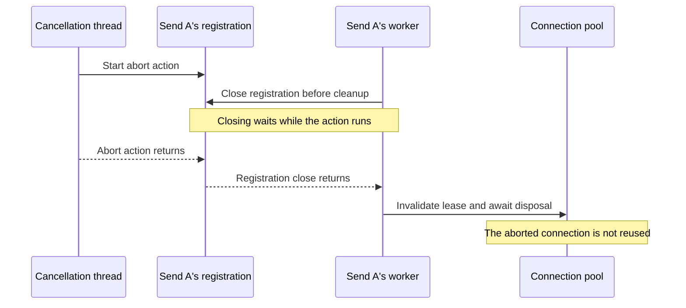

I studied concurrent programming models in Computer Science at school, where I learned the basics such as latches, semaphores and barriers, but never did I think I would actually have to use this foundation in my own projects. I mean sure, everything works on threads, but the kind of work I did for my job was mostly on top of servlets with Spring or J2EE, where this kind of thing is mostly managed (don't get me started on inherited/nested `ThreadLocal` holders, though).

Simple Java Mail, however, is not a servlet-based server type of application, but it wants to do a bunch of things at the same time; in parallel for performance, buffering for convenience, back-pressured for stability, multi-clustered for horizontal scaling and failover.

Counting sends, admitting more work and cancelling it have each needed their own answer. Some of these decisions go back years; others come from the current 10.0.0 work. Together they give a fairly good idea of what concurrency asks of a library that has to fit into somebody else's application.

## Tracking active sends: from `Phaser` to `AtomicInteger`

[Twenty years](/journal/still-the-same-ticket.html) in, Simple Java Mail employs a bunch of concurrency patterns, but [ten years ago](https://github.com/bbottema/simple-java-mail/commit/21634338b8c1c9cde8f5eaa591fb1e5d28371284), shortly after I added authenticated SOCKS proxy support, I reached for the [Phaser](https://docs.oracle.com/en/java/javase/11/docs/api/java.base/java/util/concurrent/Phaser.html).

The [SOCKS bridge](/configuration.html#section-proxy-bridge-ports) is a small local server that forwards JavaMail's unauthenticated proxy connections through an authenticated SOCKS proxy. It must start when needed, stay alive while sends depend on it, and stop when the last one finishes. I covered its origins in [A tale of two proxies](/journal/the-libraries-behind-simple-java-mail.html#a-tale-of-two-proxies).

I couldn't know the number of sends beforehand, and new ones could arrive while others were running. A `CountDownLatch` can only count down from its initial count, while a `CyclicBarrier` brings a fixed number of participants together. A `Phaser` supported the changing group: sends registered before submission and deregistered when finished. The last one out could turn off the lights.

By Simple Java Mail 6.0.0, I had [replaced it with an `AtomicInteger`](https://github.com/bbottema/simple-java-mail/commit/5411f9c6a4165c10d5c9251135dbf6d7478bbfe2). I wasn't asking sends to wait for each other or advance through phases. I was counting them: one more send, one less send. Registration happened before executor submission, and the send closure decremented the counter in `finally`.

But an [atomic counter](https://docs.oracle.com/en/java/javase/11/docs/api/java.base/java/util/concurrent/atomic/AtomicInteger.html) only protects the updates. Suppose the last send reaches zero and decides to stop the bridge, then a new send registers before `stop()` runs. Both counter updates were correct; stopping the bridge would still crash the new send mid-air.

Here is the [May 2019 implementation](https://github.com/bbottema/simple-java-mail/blob/5411f9c6a4165c10d5c9251135dbf6d7478bbfe2/modules/simple-java-mail/src/main/java/org/simplejavamail/mailer/internal/mailsender/AbstractProxyServerSyncingClosure.java#L29-L74), with logging omitted:

```java
private void increaseSmtpConnectionCounter() {
    synchronized (smtpConnectionCounter) {
        smtpConnectionCounter.incrementAndGet();
    }
}

private void shutDownProxyServerIfRunningAndCurrentBatchCompleted() {
    synchronized (smtpConnectionCounter) {
        if (smtpConnectionCounter.decrementAndGet() == 0) {
            if (proxyServer != null) {
                synchronized (proxyServer) {
                    if (proxyServer.isRunning() && !proxyServer.isStopping()) {
                        proxyServer.stop();
                    }
                }
            }
        }
    }
}
```

*Keep a new send from registering between the zero check and bridge shutdown.*

The last send holds the counter's [monitor lock](https://docs.oracle.com/javase/specs/jls/se11/html/jls-17.html#jls-17.1) through the zero check and `stop()`, so registration must take that same lock. Calling `incrementAndGet()` alone doesn't acquire it. The separate proxy lock coordinates startup and stopping; the email sends themselves run outside both locks and can overlap.

There was still a gap. The old [`stop()` closed the listening socket](https://github.com/bbottema/simple-java-mail/blob/5411f9c6a4165c10d5c9251135dbf6d7478bbfe2/modules/authenticated-socks-module/src/main/java/org/simplejavamail/internal/authenticatedsockssupport/socks5server/AnonymousSocks5ServerImpl.java#L56-L84), but returned before the listener had finished shutting down its worker pool. A new batch could start in that interval. [This was a bug](https://github.com/bbottema/simple-java-mail/commit/38b119d9633434256e403900f5ee209e778a4ced), fixed [during the 10.0.0 work](https://github.com/bbottema/simple-java-mail/issues/694#issuecomment-5393805734) by keeping the listener thread and waiting for it with `join()`.

Inside the repaired bridge, [`stop()` captures the socket and thread under its own `lifecycleMonitor`](https://github.com/bbottema/simple-java-mail/blob/38b119d9633434256e403900f5ee209e778a4ced/modules/authenticated-socks-module/src/main/java/org/simplejavamail/internal/authenticatedsockssupport/socks5server/AnonymousSocks5ServerImpl.java#L85-L114):

```java
final ServerSocket serverSocketToClose;
final Thread listenerThreadToJoin;
synchronized (lifecycleMonitor) {
    if (!running) {
        return;
    }
    stopping = true;
    serverSocketToClose = serverSocket;
    listenerThreadToJoin = listenerThread;
}
```

*Capture what shutdown needs, then release the bridge's internal lock before waiting.*

After releasing that monitor, `stop()` closes the socket and joins the listener. Holding `lifecycleMonitor` while waiting would deadlock: the listener needs it to clear its state before exiting. The outer counter lock stays held, so a new send still cannot register halfway through shutdown.

Stopping the listener doesn't kill connections it already accepted. Pooled SMTP connections may still be using their bridge sockets, so normal listener shutdown calls `shutdown()` on its worker pool rather than `shutdownNow()`. The [restart test](https://github.com/bbottema/simple-java-mail/blob/38b119d9633434256e403900f5ee209e778a4ced/modules/authenticated-socks-module/src/test/java/org/simplejavamail/internal/authenticatedsockssupport/socks5server/AnonymousSocks5ServerImplTest.java#L35-L56) checks that stopping really finishes, then occupies the old port and starts the bridge on another one. Seeing the counter reach zero wouldn't have established any of that.

## Backpressure with `ThreadPoolExecutor` and bounded queues

An asynchronous send still needs somewhere to wait when every worker is busy. An unbounded queue makes submission convenient, but lets a producer keep accumulating work faster than the server can accept it. Limiting the worker count doesn't limit that waiting backlog.

SJM's [async queue configuration](/sending-and-execution.html#section-async-queue) uses a `ThreadPoolExecutor` with three possible queue shapes:

| Capacity | Queue | What happens to waiting work |
| --- | --- | --- |
| `-1` | `LinkedBlockingQueue` | There is no configured backlog limit. |
| `0` | `SynchronousQueue` | A task must meet a worker directly; nothing is stored. |
| Positive | `ArrayBlockingQueue` | Up to that many tasks can wait, in addition to running workers. |

When the executor cannot accept another task, SJM either rejects it or waits for capacity within the configured budget. That wait delays the call to the asynchronous API; it doesn't move SMTP onto the caller's thread. A caller-supplied executor can choose different rules, but the built-in one doesn't quietly turn an async send into a caller-runs send.

The less obvious problem appears when idle workers are allowed to expire. A submission has already reached the capacity-wait handler, and meanwhile the last worker finishes its previous task and exits. With a `SynchronousQueue`, waiting for space is now rather optimistic: there is no consumer left to receive the job.

In [`MailSendExecutor`](https://github.com/bbottema/simple-java-mail/blob/0fba80c1fb7581ed94a3b52f70534071132b42c8/modules/simple-java-mail/src/main/java/org/simplejavamail/mailer/internal/MailSendExecutor.java), the wait loop starts a core worker before each timed offer, and again after a successful offer. Here is the relevant excerpt; `operation` is the submitted task and `remaining` is its remaining wait budget:

```java
prestartCoreThread();
if (getQueue().offer(operation,
        Math.min(remaining, TimeUnit.MILLISECONDS.toNanos(50)),
        TimeUnit.NANOSECONDS)) {
    if (isShutdown() && remove(operation)) {
        throw reject(AsyncQueueRejectionReason.EXECUTOR_SHUT_DOWN);
    }
    prestartCoreThread();
    return;
}
```

*A waiting producer needs a worker as well as room for its task.*

Starting before the offer gives a direct handoff someone to meet. Starting afterwards covers a buffered queue whose worker expired between the first check and insertion. The short offer intervals also let the wait loop notice shutdown and cancellation rather than disappear into one long queue wait.

The [worker-expiry regression test](https://github.com/bbottema/simple-java-mail/blob/0fba80c1fb7581ed94a3b52f70534071132b42c8/modules/simple-java-mail/src/test/java/org/simplejavamail/mailer/internal/MailSendExecutorTest.java) deliberately lets the last worker exit before resuming the rejection handler, then checks that the task runs once on a worker, not on the submitting thread. That's a different question from whether the queue is thread-safe. Both the queue and the executor can behave correctly individually while the code connecting them forgets to keep a consumer available.

## Cancellation versus completion

With a `CompletableFuture`, it is easy to tell a caller that something has finished. Whether the send has actually stopped is another question. Cancelling a future doesn't, by itself, close a socket, release a pooled connection or establish that SMTP didn't accept the email.

SJM makes that distinction explicit in its [`MailSend` handle](https://github.com/bbottema/simple-java-mail/blob/0fba80c1fb7581ed94a3b52f70534071132b42c8/modules/core-module/src/main/java/org/simplejavamail/api/mailer/MailSend.java). Each call to `getCompletion()` returns a detached future: cancelling or completing that view affects only the view. To stop the work, the caller uses [`requestCancellation()`](/sending-and-execution.html#section-send-deadlines), then checks the eventual result.

For an existing configured SJM `Mailer` and an `Email` named `email`, that looks like this:

```java
MailSend<MailSubmissionReceipt> send = mailer.async().sendMail(email);

send.getCompletion().whenComplete((receipt, failure) -> {
    if (failure != null) {
        log.warn("Send finished with a failure", failure);
    } else {
        log.info("SMTP submission result: {}", receipt);
    }
});

send.requestCancellation();
```

*Request that the send stop; let its actual completion report what happened.*

The request can retire queued work or ask a supported transport to abort its I/O. It cannot forcibly stop arbitrary application callbacks, and a late request may arrive after SMTP acceptance. Cancellation is therefore neither a recall button nor permission to retry blindly.

There is also a race before sending starts: a worker may take a queued operation just as cancellation tries to remove it. SJM uses an `AtomicReference` holding its internal operation state to decide which path proceeds. The worker must change `QUEUED` to `RUNNING`; queued cancellation must change `QUEUED` to `FINISHING`. Both use compare-and-set, so only one can win that transition.

If cancellation wins, removing the task from the queue is useful housekeeping, but the state change is what makes a concurrent dequeue harmless. Even a caller-owned executor that cannot remove the wrapper will later find nothing to execute. The [operation tests](https://github.com/bbottema/simple-java-mail/blob/0fba80c1fb7581ed94a3b52f70534071132b42c8/modules/simple-java-mail/src/test/java/org/simplejavamail/mailer/internal/MailSendOperationTest.java) cover that case as well as reclaiming space in SJM's own queue.

Required cleanup precedes result completion. An inline observer also returns before the result completes; an observer on an application executor only needs to have been handed off. Waiting for the send's result doesn't wait for all the application work somebody may attach to it.

## Safe cancellation of pooled connections

A pooled connection can outlive the send that borrowed it. That makes a delayed cancellation callback more dangerous than an ordinary late result: it could close a connection that is already carrying somebody else's email.

SJM's internal `MailSendControl` therefore registers stop actions for specific claims and transport leases. A *lease* is one send's temporary use of a connection. Cancelling a thread waiting to acquire one must wake that waiter, not abort the connection's current borrower.

Once a send has a lease, its abort action stays registered only for that use. Before returning a healthy connection to the pool, the send closes the registration. If an abort action has already started on another thread, closing must wait for it to finish; merely removing the callback from a list would leave the running action free to interfere with the next borrower.

The two retirement cases are:

| Stop action at retirement | What closing the registration does |
| --- | --- |
| Not started | Prevents it from starting, even if a cancellation thread already selected it. |
| Already running elsewhere | Prevents another start and waits for the running action to return. |

In the second case, an aborted connection must be discarded rather than reused:



*Finish the old abort action before retiring its connection, so it cannot escape into another send.*

This is called [registration fencing](https://github.com/bbottema/simple-java-mail/blob/0fba80c1fb7581ed94a3b52f70534071132b42c8/docs/concurrency/05-stop-registration.md): closing establishes that the old action cannot continue into the next use. The callback runs outside the registration's bookkeeping lock, allowing the closing thread to wait without preventing the action from finishing. It must be a short internal stop action, not application code that might wait indefinitely.

The [pooled-cancellation tests](https://github.com/bbottema/simple-java-mail/blob/0fba80c1fb7581ed94a3b52f70534071132b42c8/modules/simple-java-mail/src/test/java/org/simplejavamail/mailer/MailSendExecutionControlTest.java) check both sides: cancelling a waiting claimant leaves the current borrower alone, while aborting one active lease doesn't disrupt other healthy leases. A later send gets fresh result facts, and an old handle can't cancel it.

## Detecting callback self-waits with `ThreadLocal`

A Mailer has to [drain accepted work before closing its resources](/sending-and-execution.html#section-async-queue). That includes an inline completion observer, because the send hasn't finished reporting until the callback returns. Now imagine that callback calls `mailer.close()`.

The callback waits for the Mailer to shut down, while shutdown waits for the callback to return. More locks won't resolve that circle.

SJM uses `ThreadLocal` context to recognize when the current thread is already working inside that Mailer. Its [`close()` guard](https://github.com/bbottema/simple-java-mail/blob/0fba80c1fb7581ed94a3b52f70534071132b42c8/modules/simple-java-mail/src/main/java/org/simplejavamail/mailer/internal/MailerImpl.java) checks both the operation context and the identity of an SJM-owned executor worker:

```java
public void close() throws ExecutionException, InterruptedException {
    if (mailSendOperations.isCurrentOperation()
            || (ownsMailSendExecutor()
                && MailSendExecutor.isCurrentWorker(
                    operationalConfig.getExecutorService()))) {
        throw new IllegalStateException(
                "A Mailer worker cannot wait for its own shutdown; "
                + "close the Mailer from its owning application thread");
    }
    shutdownConnectionPool().get();
}
```

*Reject a self-wait before starting shutdown; let the application close the Mailer from outside its callback.*

Here, `ThreadLocal` records which Mailer this thread is working inside. Checking the operation as well as the worker matters because synchronous sends and caller-supplied executors can run on threads SJM didn't create.

The marker is installed around execution and inline reporting, then the previous context is restored in `finally`. Nested work must leave the surrounding context intact when it returns or throws. Simply clearing a `ThreadLocal` at the end of every nested call would erase information the outer operation still needs.

The [observer-close regression test](https://github.com/bbottema/simple-java-mail/blob/0fba80c1fb7581ed94a3b52f70534071132b42c8/modules/simple-java-mail/src/test/java/org/simplejavamail/mailer/MailSendQueueTest.java) checks that the callback gets an `IllegalStateException`, the send completes and the Mailer stays open until the application closes it elsewhere. It is a targeted self-wait guard, not a detector for every dependency cycle an application can create. Explicitly waiting on `shutdownConnectionPool().get()` inside the callback would bypass it.

## Reproducing concurrency bugs with `CountDownLatch`

Running a test a thousand times might encounter a race. It also might miss it a thousand times. For these bugs, the useful question is whether the test can hold one thread at the point another thread needs to cross.

The registration-fencing test uses a pair of `CountDownLatch` instances: one announces that the stop action has started, and the other keeps it there until the test releases it. These excerpts come from [`closingRegistrationFencesAnAlreadyRunningAction`](https://github.com/bbottema/simple-java-mail/blob/0fba80c1fb7581ed94a3b52f70534071132b42c8/modules/core-module/src/test/java/org/simplejavamail/internal/util/concurrent/MailSendControlTest.java). Here `control` is SJM's internal stop control, `watcher` is the test's scheduled executor, and `await` is its helper for a bounded latch wait:

```java
final CountDownLatch release = new CountDownLatch(1);
final CountDownLatch entered = new CountDownLatch(1);
final MailSendControl.Registration registration = control.onStop(() -> {
    entered.countDown();
    await(release);
});
watcher.execute(control::requestCancellation);
assertThat(entered.await(2, SECONDS)).isTrue();
```

*Hold the stop action in progress before asking another thread to retire it.*

The test then starts a separate closing thread. Starting it alone doesn't prove it has reached the wait, so `awaitRegistrationCloseWaiting` checks for the waiting thread state with `Registration.close()` on its stack. Only then does the test release the action:

```java
final FutureTask<Void> closing = new FutureTask<>(registration::close, null);
final Thread closingThread = new Thread(closing, "registration-closing-test");
closingThread.start();
try {
    awaitRegistrationCloseWaiting(closingThread);
    assertThat(closing).isNotDone();
    release.countDown();
    closing.get(2, SECONDS);
} finally {
    release.countDown();
    closingThread.join(SECONDS.toMillis(2));
    assertThat(closingThread.isAlive()).isFalse();
}
```

*Verify that close really waits, then release the action and check that both threads finish.*

The complete test shuts down its scheduled executor in `finally`; its bounded waits make a broken test fail rather than hang the test suite. The timeouts aren't an attempt to guess how long the race takes. They limit how long the test will wait for explicitly arranged events.

The queue tests use the same idea to hold workers and force saturation or expiry, while pooled tests hold an SMTP phase open to exercise cancellation. Each test establishes a particular interleaving, not every possible one. But it gives the implementation something far more useful than a lucky run: a repeatable description of the situation it must handle.

The retry tests now use latches in much the same way. Once the test server reaches a temporary SMTP refusal, the test can check what happens during backoff: the send releases its worker and connection so another message can proceed, while shutdown still waits for the parked retry. Other retry tests bring two sends to the same refusal point before either continues, proving that their receipts and connection histories remain separate. None of this depends on a well-placed sleep or a lucky scheduler.

What I like about these examples is that they make the choice of tool concrete. The bridge needed a count and a completed shutdown; the executor needed a bounded backlog and available workers; cancellation needed its own request and cleanup rules. A familiar concurrency class can help with each of those, but it doesn't choose the behaviour the library should promise. That part is still engineering.
