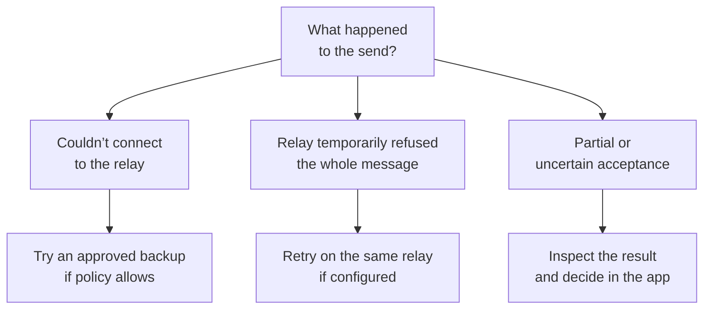

*By our powers combined! Captain Simple Java Mail! No, the words don't carry equal weight.*

Simple Java Mail. Three fairly unambiguous words, you would think. It is written in Java, it deals with email, and it must be a fairly basic little library. Right? Wrong. The word *Simple* has been doing rather more work than I anticipated when I created this library, and not all of it in my favour.

## Java and Mail get off lightly

The **Java** part tells you where it belongs. It fits into a Java application, uses the Jakarta Mail foundation, and has [Spring integration](/spring.html) for applications that already speak that language.

**Mail** deserves a small qualification: this is about composing, inspecting, protecting and submitting email. Simple Java Mail isn't an inbox client, nor does it take over your SMTP server's onward delivery.

Then there's **Simple**. The black sheep of the family.

## Simple was always about the person using it

I meant simple to use. Repeat with me: "Simple. To use."

In the [origin story](/journal/simple-java-mails-origin-story.html), the problem was an email that looked different depending on which client opened it. I eventually worked out a MIME tree that could hold plain text, HTML, attachments and embedded images. Having done that work, I didn't see why any developer after me should have to go through that pain again.

For years I used the same `mixed` → `related` → `alternative` tree for everything, even plain text. When someone asked about sending plain-text mail in [#133](https://github.com/bbottema/simple-java-mail/issues/133), I tried it in Outlook 365 and found a phantom paperclip on a message with nothing attached. That sent me back to the MIME builder, and in [#144](https://github.com/bbottema/simple-java-mail/issues/144) I switched SJM to eight layouts so it could pick one based on what the message actually contains.

The application already knew what it wanted to say; why make it describe an academically formulated exact MIME tree to match? SJM supports that simple to use API to this day:

```java
SimpleJavaMail mail = SimpleJavaMail.fromDefaults();

Email email = mail.emailBuilder().startingBlank()
    .from("Benny", "benny@simplejavamail.org")
    .to("Reader", "reader@yourcompany.com")
    .withSubject("Simple doesn't mean small")
    .withPlainText("Describe the email you want to send.")
    .withHTMLText("<p>Describe the email you want to send.</p>")
    .withAttachment(Path.of("guide.pdf"))
    .buildEmail();
```

*The application describes its message; the library works out the MIME structure.*

Now compare that to using Jakarta Mail directly. First, you have to know that for this specific combination of fields and content, you need the following MIME structure:

```text
multipart/mixed
├── multipart/alternative
│   ├── text/plain
│   └── text/html
└── guide.pdf (attachment)
```

This is the part people often don't realize when they follow some tutorial and copy some example; if you don't match the exact needs of your message to the [appropriate MIME structure](/rfc-compliant.html), you risk clients rendering the message inconsistently.

Here's that tree in Jakarta Mail.

```java code-expandable
Session session = Session.getInstance(new Properties());
MimeMessage message = new MimeMessage(session);

message.setFrom(new InternetAddress("benny@simplejavamail.org", "Benny"));
message.setRecipient(Message.RecipientType.TO,
    new InternetAddress("reader@yourcompany.com", "Reader"));
message.setSubject("Simple doesn't mean small", "UTF-8");

MimeBodyPart plainText = new MimeBodyPart();
plainText.setText("Describe the email you want to send.", "UTF-8");

MimeBodyPart html = new MimeBodyPart();
html.setText("<p>Describe the email you want to send.</p>", "UTF-8", "html");

MimeMultipart alternatives = new MimeMultipart("alternative");
alternatives.addBodyPart(plainText);
alternatives.addBodyPart(html);

MimeBodyPart body = new MimeBodyPart();
body.setContent(alternatives);

MimeBodyPart attachment = new MimeBodyPart();
attachment.attachFile("guide.pdf");

MimeMultipart mixed = new MimeMultipart("mixed");
mixed.addBodyPart(body);
mixed.addBodyPart(attachment);

message.setContent(mixed);
message.saveChanges();
```

The Jakarta Mail example gets us as far as building the message. Once I’ve configured a `Mailer` with the SMTP server, credentials and TLS settings, I can call `mailer.sync().sendMail(email)` and let SJM apply my defaults and overrides, check the sender and recipients, and [scan for header injection](/security.html#section-crlf-scanning) before it builds and submits the MIME message.

Jakarta Mail gives me the pieces to assemble a MIME message, but I wanted to describe the email in terms of recipients, message bodies and attachments and leave the MIME tree to the library. Or, as I used to put it on the old website, “Just send the damn mail!”

## Lightweight became a rather heavy label

For years I described Simple Java Mail as a lightweight library. That sounds reassuring: a small dependency, a short learning curve, no grand framework to adopt just to send an email. It also sounds like something you might outgrow.

For much of the past decade, the website wasn't helping. I'd taken inspiration from another open-source project's website, but as the library grew, its presentation hadn't kept up. I was so busy adding capabilities that I hadn't noticed how little the website did them justice. A developer considering it for a larger system could quite reasonably come away with the impression of a convenient little wrapper around Jakarta Mail.

[](/assets/journal/articles/the-simple-in-simple-java-mail/pre-redesign-homepage.png)

*The Simple Java Mail homepage before the redesign.*

The old homepage said “Simple API, Complex Emails,” then showed a few lines that sent one email. I’d made it easy to see how to get started, but you had to dig to find the connection pools, SMTP clusters, authenticated SOCKS, signing and encryption, message conversion and diagnostics that made the library useful when the work got harder.

On **25 November 2026** I counted a few things in the 10.0.0 development checkout to see how well “lightweight” still described it.

- **66 entries in the [capability catalogue](/features.html)**, grouped into seven families. You can start with the [message builder](/email-composition.html#section-builder-api) and come back to [inspect a message someone else sent you](/email-conversion.html#section-source-inspection).
- **119 named entries in the [configuration registry](/configuration.html#section-available-properties)**. Three are wildcard families for named Mailers, connection-pool clusters and extra properties.

I even considered renaming the library to **Total Java Mail** for the 10.0.0 release. It wouldn’t have been my first rename, considering I started out with [Vesijama](/journal/simple-java-mails-origin-story.html#what-s-a-vesijama). By then, the repository had around [1,300 stars on GitHub](https://github.com/bbottema/simple-java-mail), and Simple Java Mail was a familiar name to people [looking for a Java SMTP library](/feature-matrix.html). I didn’t want to throw away that recognition just to change the impression the name gave.

I kept the name and put that energy into making harder mail problems easier to see on the website and easier to solve with the library. I want someone who starts with one email to think of SJM again when they’re asked to build a mail service for the whole company.

## Getting enterprise teams to look past “Simple”

I wanted enterprise teams to recognise their own mail problems on the site, so I wrote [case studies](/case-studies.html) around three fictional companies and the decisions their developers had to make.

<table class="journal-case-study-table" aria-label="Case studies">
<tbody>
<tr>
<td>

At [Polar Meridian Systems](/case-studies/polar-meridian.html), login codes need to go out while Marketing sends a newsletter to 300,000 people, so Ravi gives urgent mail its own queue and Mailer.

</td>
<td>
<a href="/case-studies/polar-meridian.html" aria-label="Read the Polar Meridian Systems case study">
  
</a>
</td>
</tr>
<tr>
<td>

A troll farm uses the quotation form at [Staple & Sons](/case-studies/staple-and-sons.html) to send spam, leaving invoices and password resets stuck in the same queue. The developers close the loophole and use Simple Java Mail’s sending limits to get legitimate mail moving again at a rate their servers can handle.

</td>
<td>
<a href="/case-studies/staple-and-sons.html" aria-label="Read the Staple &amp; Sons case study">
  
</a>
</td>
</tr>
<tr>
<td>

When a customer changes its SMTP password at [RelayDesk](/case-studies/relaydesk.html), Sam has to fix that route while everyone else’s replies keep going out through their own connections. There is also an orc, but I’m reasonably sure that’s not an enterprise prerequisite.

</td>
<td>
<a href="/case-studies/relaydesk.html" aria-label="Read the RelayDesk case study">
  
</a>
</td>
</tr>
</tbody>
</table>

#### From case studies to patterns

The case studies tell the whole story, but sometimes you just want to know what to do on Monday morning when an invoice that the SMTP server accepted on Friday comes back as undeliverable. That’s one of the **27 recipes** in [Tactical Patterns](/email-workload-field-guide.html): the [invoice recipe](/email-workload-field-guide.html#the-invoice-was-accepted-then-bounced) shows how to match the delivery report to the original send.

If you want to see what happens to the invoice after that, [Strategic Patterns](/strategic-patterns.html) has **10 runnable applications**. In the [mail feedback example](/patterns/incoming-feedback.html), you can submit the same delivery report twice and watch the application update the job and notify a business service just once. SJM reads the report, and the application uses it to decide what happens to the invoice.

I want “Simple” to hold up from that first email to the day you have to run it at scale.

- Simple to get started
- Simple to find a workflow that fits
- Simple to configure
- Simple to troubleshoot
- Simple to scale

That's the Simple Java Mail I wanted enterprise teams to see.

## Looking outside Java raised the bar

The [Compare libraries page](/feature-matrix.html) asks what work remains in your application when you choose among the Java mail APIs. That is useful, but staying inside that comparison would give me a rather comfortable view of my own project.

The wider SMTP-client research compared nine library stacks across seven language ecosystems. It excluded hosted delivery APIs, inbox protocols and full mail servers: I wanted to compare the software a developer uses to construct and submit an email. The [original research](https://github.com/bbottema/simple-java-mail/blob/codex/10.0.0/docs/research/simple-java-mail-world-class-smtp-research.pdf) dates from August 2026; the [progress companion](https://github.com/bbottema/simple-java-mail/blob/codex/10.0.0/docs/research/simple-java-mail-world-class-smtp-progress-report.md) records what changed afterward.

Here is the short version of the challenge those projects set:

| Library | What makes it worth looking at |
| --- | --- |
| [MailKit](https://mimekit.net/docs/html/T_MailKit_Net_Smtp_SmtpCapabilities.htm) / [MimeKit](https://mimekit.net/), .NET | Broad modern SMTP-extension support, alongside a substantial MIME and cryptographic toolkit. A serious bar for protocol coverage. |
| [Nodemailer](https://nodemailer.com/smtp/pooled), Node.js | Reusable SMTP pools, sending limits and capacity notifications that help applications feed work without piling everything into memory. |
| [Symfony Mailer](https://symfony.com/doc/current/mailer.html), PHP | Framework integration, failover transports, testing facilities and asynchronous jobs through Messenger. |
| [Vert.x Mail Client](https://vertx.io/docs/vertx-mail-client/java/), Java | An asynchronous client with connection pooling and negotiated PIPELINING; a different execution model from dispatching blocking SMTP work to workers. |

*The comparison changes depending on whether you care about protocol coverage, operating the workload or integrating it into an application.*

These projects have had years to find out what goes wrong when real applications depend on them, and you can see what their maintainers learned in the way they handle busy pools, failed sends and framework integration. I’d be doing Simple Java Mail a disservice if I didn’t take the time to understand what’s made them worth using for so long.

#### The work that took me upstream

Some of that comparison took me upstream to Angus, the SMTP provider behind SJM. Angus merged my [fix for leading dots in CHUNKING transfers](https://github.com/eclipse-ee4j/angus-mail/pull/210). Version 10 includes the [negotiated PIPELINING support I contributed to Angus](https://github.com/eclipse-ee4j/angus-mail/pull/220). When enabled and supported by the relay, it lets the client send several envelope commands before waiting for the replies. The investigation even led to [hostname-verification fixes in Angus](https://github.com/eclipse-ee4j/angus-mail/pull/242) and [a bug report further upstream in Google's Conscrypt](https://github.com/google/conscrypt/issues/1567).

## Version 10 takes Simple past the happy path

#### When a send goes wrong

Say your application sends a reply to three people and the relay accepts just one. If all the application gets is an exception, should it send the whole reply again? In 10.0.0, [the send result](/analyzing-send-results.html#section-retry-decisions) shows who the relay accepted, who it refused and where acceptance is still uncertain, so the application can decide whether to try again.



*Whether to use [connection failover](/smtp-connection-failover.html) or a [bounded retry](/mail-send-retries.html) depends on what happened in the first attempt.*

#### What can I find out about a send?

- **Which settings did the Mailer use?** [Trace the loaded configuration](/debugging.html#section-config-diagnostics).
- **What would this message require?** [Rehearse it before connecting](/debugging.html#section-email-validation).
- **Where did the send slow down?** [Inspect an OpenTelemetry trace](/opentelemetry.html#section-traces).

#### Can I trust this attachment?

Once SJM decrypts a partner’s PDF, you get the attachment along with [the evidence to check its protection](/security.html#section-inspecting-received-protection). Your application can check whether a key you’ve approved signed the whole document before deciding what to do with it. In the [runnable partner-document example](/patterns/protected-partners.html#check-the-required-document), you can see which documents the application accepts and which it holds for review.

**Version 10 takes on more of the work so email stays simple for the developer.**

## I'm keeping the Simple

<a href="/assets/journal/articles/the-simple-in-simple-java-mail/captain-sjm-darkmode.png"></a>

*yes... it's Captain Simple Java Mail*

The new [homepage](/#start-small) starts with a simple email and follows it all the way to delivery feedback. When you come back with a harder problem of your own, you can try a recipe, run an example or see how a team approached it in a case study.

I still want that first email to be straightforward, and I want it to stay that way when you need to sign it, switch SMTP routes, set a deadline or find out which recipients the relay accepted.

I’m keeping the Simple.
