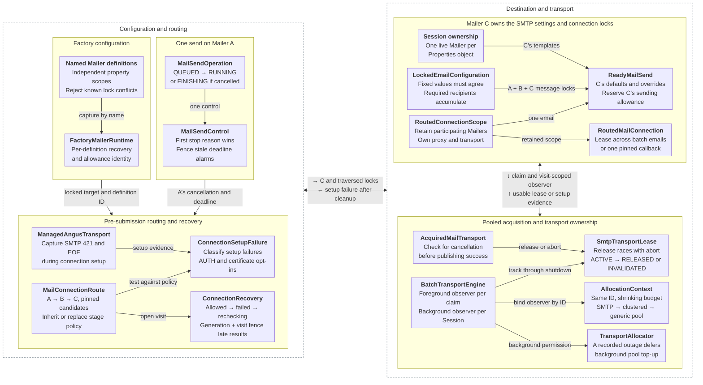

I asked a coding agent to implement SMTP connection failover in Simple Java Mail. The public API looked deceptively simple: _If connecting to one approved server fails, try another, within the rules the application has chosen_. Great addition. How complicated could it be?

```
primaryBuilder.withFailoverMailer(backupMailer, failoverPolicy)
```

Well... complicated enough that the first acceptance stage alone took **thirty** review batches. I was struggling to absorb the individual batches, so I asked the agent for an architectural overview and found that hard to take in too.

I’ve maintained SJM for almost twenty years, and knowing how it works has always been part of the job and part of the pleasure. Now I can make it grow faster than I can understand everything being added.

That's exciting, but is also making me very uncomfortable. I'm literally living the Singularity, one perfectly reasonable decision at a time. Are we frogs in the pot, letting AI make more of the decisions until we can't explain our own software, or are we moving up a level as designers and architects, with more time to think about what it should do?

## A small API, a very large change

[Connection failover](/smtp-connection-failover.html) sounds like a matter of choosing another server. In the implementation, choosing that server also means choosing the right Mailer's message defaults (you can have multiple in a cluster), validation, signing settings and connection configuration, while the Mailer that initiated the operation still handles its executor, timeouts, cancellation and completion.

[](/assets/architecture/inside-a-mail-send.png)

*failover reaches into all layers*

Reviewing `failover` meant keeping track of who owned what across those layers as a send changed destinations.

<div id="failover-internals" class="journal-diagram-wide" data-diagram-lightbox>



*I’d asked for failover, and here we were tracing an unexpected `From` address back to a second Mailer taking over a shared `Session`’s properties. The same question of who owned what came up again when cancelling a recheck made the library forget that another connection had succeeded.*

</div>

<!-- Source grounding: docs/failover/architecture.md, especially sections 1, 2, 4, 6 and 7, in the parent repository's 10 October 2026 working tree. The thirty review batches are the author's recollection, not a test or document count. -->

Each concern is reasonable when considered on its own. What dazzles me is how many have to remain correct together, including concerns added only recently. I can follow a particular path through the code, but keeping the whole implementation warm in my head has become much harder.

This isn't just a matter of an agent producing too much boilerplate. The library is becoming more capable, and more capability means more machinery to wire up. It's become a team-sized project, but it's still just me... and my team of coding agents. I'm still figuring out how much of the implementation I need to understand to make good decisions about the design and the API.

## <strong>I started with autocomplete</strong>

I started with GitHub Copilot’s preview in 2021, and by 2023 IntelliJ’s AI Assistant was suggesting whole methods as I typed. In 2025 I went from talking through an open file with Junie to handing off tasks with Claude Code and the Codex IDE extension. I picked up the Codex app when it came to Windows in 2026 and still use it for my own projects, while at work I use Claude Code through AWS Bedrock.

When I hand over the whole job, am I still the developer, or just the user dishing out requirements?

## Sometimes I don't review the code at all

For hobby tools that solve a short-/medium-term problem, I've had agents generate whole applications without reviewing any of the implementation. That makes me extremely productive; I can get a first version running in a few hours. For example, I'm editing this article in a custom generated markdown editor that allows me to edit it directly in the rendered final result. The ability to create tools like this is a total game-changer.

[](/assets/journal/articles/is-it-still-my-library/article-workbench-markdown-editor.png)

*Editing this very paragraph in the Article Workbench*

When I ask an agent to review and repair its work, I'm delegating part of the scrutiny as well as the construction. I judge the application by using it and probing the problems I notice, while models inspect implementation details I haven't read.

**SJM is a different experience, however.** I don't have the same distance from its code, or the same willingness to treat an implementation as replaceable once the immediate problem has passed. Its users may depend on decisions I make for years. When something breaks, I want to know where to look. If I lose track of how the pieces fit together, I can see myself spending round after round asking an agent to untangle the problem. For SJM, I’m both the product owner and the architect.

## Twenty years of engineering are helping me now

SJM lends itself unusually well to coding agents because it already has a clear shape. I'm pretty meticulous, and almost twenty years of that shows up in its separation of concerns, modular design, documentation philosophy and established patterns.

I described some of this in [The Library I Keep Coming Back To](/journal/the-library-i-keep-coming-back-to.html). The [Coding Style guide](https://github.com/bbottema/simple-java-mail/blob/cc1db5122ecd06e8f0f0cd698a5f5dbb7cb131ee/CODING_STYLE_GUIDE.md) is the culmination of my experience as a software engineer, while the [API expansion workflow](https://github.com/bbottema/simple-java-mail/blob/codex/10.0.0/docs/API_EXPANSION_WORKFLOW.md) explains how a change needs to reach the relevant parts of the project. I also went back through old commits and GitHub discussions to write more than 40 [architecture decision records](https://github.com/bbottema/simple-java-mail/tree/codex/10.0.0/docs/adr), filling in the reasoning that had only ever lived in my head.

All this to say an agent has more to work with than whichever instruction I happened to type today.

I’d been shaping SJM this way for years by the time coding agents came along. I consider coding a craft, and the codebase is my public business card. I want anyone working on it, including me, to be able to follow the code and clearly see functional flow before all the technical SDK calls.

That investment helps me recognize when an agent goes off the rails. A solution may work locally but put the process in the wrong place, bypass the public API's intended shape or introduce a pattern that doesn't fit the rest of the library. That’s why I’ll go through thirty batches of diffs for SJM. Even when I’m skimming, I can spot the changes that deserve a closer read.

## At work, we still slow the agents down

At my full time day job we deliberately slow down Claude so we can keep up with reviews and our technical understanding of the system. Senior developers are selected to [guide agents and review their output](https://arxiv.org/abs/2512.14012). Between disposable hobby tools and a library whose shape I know intimately, that is the middle ground I work in today.

As developers who know a system rotate out, I expect their replacements to acquire less of that implementation-level understanding. And if Claude can implement a feature or investigate a bug, why spend the same amount of time building the mental model yourself? Repeat that through a few handovers and I can see the team coming to rely on Claude to understand the code it’s still reviewing. From there it's a small step to not bother with understanding the technical implementation at all. That’s what makes me uncomfortable.

How long before reading the code ourselves starts to feel obsolete?

## Let the agent grill me instead

For the `failover` addition, I had the agent grill me about scope, constraints and runtime behavior before implementing it. What should a send promise? When should it stop? Which settings should apply if another destination is selected? How should this feel to the developer using the API?

Those are decisions I know how to make, and they give me something to look for when the code comes back. I want to be able to follow a send through the code, see where I’d make the next change, and recognize the API as something I’d want to use.

Review can extend beyond me inspecting a diff. I can ask another model to assess the implementation, much as I would ask one developer to review another's work, or ask for an architectural assessment that challenges how the pieces fit together. Tests, targeted investigations and questions about claimed behavior give me other ways to probe it. I often ask for diagrams that demonstrate how the layers encapsulate the solution and where the interactions cross boundaries.

Those checks give me a way to decide whether a change is ready, even when I couldn’t explain every part of it myself. I can see the sense in working this way and still feel uneasy when I have to ask an agent how my own library works.

## Is it still my library?

The project SJM is becoming in a matter of days is approaching the size and complexity of systems I've encountered at work with a whole team dedicated to them. Those systems, on the other hand, also carry years of legacy and changes made by people who didn't quite understand the original intentions; here I have an opportunity to preserve a more consistent direction, provided I keep the agents on rails.

Even with those rails, I find myself wondering whether I'm still good enough to steward SJM. Do I develop the library, or just its rails?

I've wondered whether I should shelve `failover` and some of the other recent additions for 10.0.0 because of the complexity they introduce. Yet their value is hard to deny. I want SJM to be the best SMTP library in the world, and the [comparison work](/journal/the-simple-in-simple-java-mail.html#looking-outside-java-raised-the-bar) has made that ambition much more concrete. I'm making real progress toward it, but at what cost?

## A shepherd of coding agents. For how long?

I've joked to colleagues that I'll probably become a shepherd, herding a swarm of coding agents. Internally, I wonder whether future talent will be hired partly on how many projects they can manage at once with those agents.

Underneath the joke is a less cheerful question: am I becoming obsolete?

Learning to work with agents might not be enough to preserve a distinct developer role. Product owners, architects and analysts can use them too. If they can handle the concerns left after implementation is delegated, where does an in-house developer fit? And if models take over more of the analysis and architecture, moving into one of those roles doesn't necessarily provide a permanent refuge either.

I'm not alone in wondering about this. Anthropic's [December 2025 workplace study](https://www.anthropic.com/research/how-ai-is-transforming-work-at-anthropic) describes engineers taking on broader work with AI while worrying about losing deeper expertise, their relationship with the craft and their eventual relevance.

OpenAI used Codex to build [Pando](https://openai.com/index/scaling-git-at-openai/), the Git backend it needed to keep up with Codex.

Who’s shepherding whom now?

## What happens when the customer builds the software?

My code-illiterate brothers use coding agents too, and in our WhatsApp group we regularly talk about the software they make for their hobbies. One created his own audio plugins and a stock broker simulator to backtest stock strategies, the other an RPG workbench with embedded music player, dice mechanics etc. Brandon Thomas’s team pushed the idea of software on demand much further, using coding agents to get a first version of a [Photoshop-like image editor](https://ai.engineer/code/2026/talks/brandon-thomas) working in a day.

If I can ask for just the parts of Photoshop I need for one job, what exactly am I subscribing to Adobe for? Once enough people start asking that, I think a lot of software vendors are going to have a problem.

I picture asking for the software I need today and adapting it as the job changes. **Star Trek’s food replicator, but for software.**

[](/assets/journal/articles/is-it-still-my-library/software-replicator.jpg)

Someone could ask an agent to build an app that includes sending email, and **the agent might pick Simple Java Mail without the customer ever seeing the SJM website**.

## Who am I writing the cyberpunk story for?

I've spent a rather enjoyable amount of time turning [RelayDesk](/case-studies/relaydesk.html) into an elaborate cyberpunk case study, complete with portraits, neon diagrams and an orc doing an integration-repair gig.

If my next reader is a coding agent looking for an API call or a configuration setting, where does that leave the story, the artwork and all the effort I put into making it a good read?

I suppose it was mostly self-indulgence anyway, I had a lot of fun making it. That doesn't stop me wondering whether the human audience I'm picturing will still be there, or whether I'm lovingly decorating something my future readers won't even see. Maybe in the future a coding agent needs a chuckle, too.

<a href="/case-studies/relaydesk.html" aria-label="Read the RelayDesk case study">
  
</a>

## I'm not ready to let go

That deceptively simple call to `withFailoverMailer(...)` is now [part](/smtp-connection-failover.html) of Simple Java Mail 10.0.0.

I’ll probably ask an agent to build the next feature too, and if I have to fix it a year from now, I hope I still know where to look. Otherwise, I’ll ask a coding agent to show me. Or maybe I won’t even go looking anymore...
