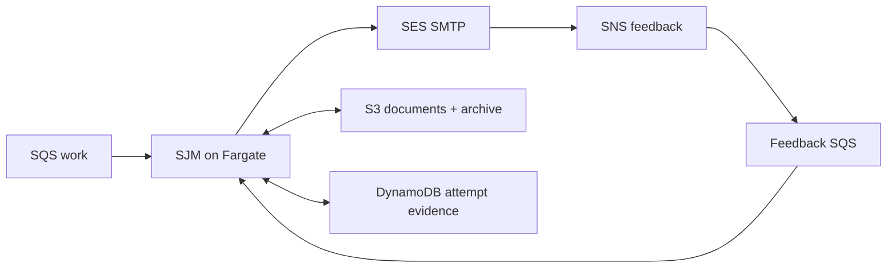

## Start here

Download and extract the [complete Simple Java Mail sources](https://github.com/bbottema/simple-java-mail/archive/refs/heads/codex/10.0.0.zip), or use your existing [matching source checkout](https://github.com/bbottema/simple-java-mail/tree/codex/10.0.0). Open a terminal in the directory containing `pom.xml` and `tools/`.

Use Docker Engine/Desktop with Linux containers and Compose 2.24.4 or newer. Allow several GB of disk space and at least 4 GB of Docker memory; brokers and workflow engines may need more. No host JDK, Maven or real mail account is needed.

Run these commands from that directory:

```text
docker compose -f tools/integration-patterns/aws-correspondence/compose.yaml up --build -d --wait
docker compose -f tools/integration-patterns/aws-correspondence/compose.yaml run --rm scenario
```

Open [the local job evidence](http://localhost:8787/jobs). Repeated input should produce one submission; rejected or uncertain attempts remain held. Delivery feedback is recorded separately.

Docker builds the matching source; no host Java/Maven or cloud account is needed. ElasticMQ, DynamoDB Local, S3Mock and the TLS SMTP fixture exercise application contracts. SES JSON is explicitly injected. This is **not** a local reproduction of AWS or SES conformance test.

## Follow one job

Begin at [`CorrespondenceWorker.deliver`](https://github.com/bbottema/simple-java-mail/blob/codex/10.0.0/tools/integration-patterns/aws-correspondence/src/main/java/org/simplejavamail/examples/aws/CorrespondenceWorker.java). Follow its claim into `prepareArchiveAndSubmit`, then `recordOutcome` for the terminal SMTP facts. Read `recordFeedback` as a second path: later SES JSON shares the job identity, but is not part of the original SMTP operation or database transaction. Start with the local application before opening the Terraform or CloudFormation templates.

Inspect `/jobs`: the lost-reply attempt stays held, and a late delay does not overwrite recorded delivery. Only after understanding those local checks should you consider the separate, billable AWS deployment.

## The problem

An AWS application prepares protected partner correspondence, retains submission evidence and reacts to later feedback. A queue cannot make SMTP exactly-once, and SES does not replace application preparation or business decisions.

## Where SJM fits

An SQS job references an S3 document. A persistent Fargate worker claims it in DynamoDB, prepares signed/encrypted mail through SJM, retains the finalized representation and submits through SES SMTP. A reusable Mailer can keep its connection pool across jobs.



SJM handles MIME, configured protection and SMTP submission. AWS supplies durable queues, object storage, conditional updates and delivery infrastructure. The application owns permission, duplicate protection and reconciliation.

There is no public HTTP endpoint, load balancer, workflow engine or inbound SES receiving service. Its development certificate is synthetic; this is not production partner-identity management.

## SES feedback

A dedicated configuration set publishes events through SNS into the feedback queue. Application attempt tags connect events to the stored recipient/job. Do not assume SES preserves the application's Message-ID.

These events are SES JSON, not MIME reports. The worker retains duplicate/out-of-order-aware evidence. Use [Reading delivery reports](/delivery-reports.html) for actual received notification emails.

Client-to-SES TLS is distinct from SES's onward TLS policy. S/MIME protects content; neither an SMTP response nor a delivery event proves a person read or decrypted it.

The scenario checks duplicate input, protected archive hashes and duplicate/out-of-order feedback. Rejected or uncertain submissions stay held, and
uncorrelated feedback reaches a dead-letter queue rather than silently changing a job. Captured synthetic mail never leaves the fixture.

## Identify the application to SES

A container's generated hostname is not necessarily a useful SMTP client identity. The worker uses `ConnectionConfig.Builder.withSmtpClientHostname("correspondence.example.test")`
instead of depending on that runtime default. Choose your deployment's approved hostname for real correspondence. This changes EHLO/HELO, not the sender,
SES endpoint or TLS certificate checks, and requires no DNS changes from the demo script.

## AWS deployment

The source includes equivalent Terraform and CloudFormation foundation/worker deployments with a shared runner. Both pin the same worker application to an ECR image digest and use the same configuration contract.

Supply an explicit profile, expected account, region, unique run name, existing verified SES domain and sender. `preflight` verifies inputs; `plan` validates without provisioning. `deploy`, `scenario`, `status` and `destroy` act on that recorded run.

The deployment creates its own network, no-ingress task security group, ECR repository, queues/DLQs, bucket, table, configuration set, feedback subscription, logs and scoped roles. Demo-only SMTP credentials go to Secrets Manager outside templates/state, never an image or download.

The existing sending identity is read-only. No DNS, identity default, suppression setting or production feedback route is changed. Do not point both deployment formats at the same resources or use the scripts to adopt existing infrastructure.

Real-cloud scenarios use SES mailbox simulator addresses. They verify submission/feedback and archive storage, not partner decryption. Read the dated verification record for what was deployed, observed and cleaned up. Cloud resources incur charges; local fixtures do not establish IAM/network equivalence.

For example, SMTP acceptance followed by a simulated bounce produces these separate facts:

```json
{"case":"bounce","smtp":"ACCEPTED","feedback":["Bounce","Send"],"archiveHashMatches":true}
```

The later bounce does not rewrite the earlier submission result or authorize an automatic resend.

The inline result observer also keeps SMTP acceptance if connection cleanup subsequently fails. That operation is held for inspection, not relabeled as
a rejected submission. If evidence storage itself fails, the persistent `SENDING` guard remains in place for reconciliation rather than automatic replay.

## Source and cleanup

[Download the sources and cloud scripts](/assets/guides/integration-patterns/strategic-patterns.zip). The [AWS source README](https://github.com/bbottema/simple-java-mail/tree/codex/10.0.0/tools/integration-patterns/aws-correspondence) supplies exact commands, prerequisites and ownership safeguards.

```text
docker compose -f tools/integration-patterns/aws-correspondence/compose.yaml down --volumes --remove-orphans
```

Cloud resources are separate: use `destroy` with the same arguments/manifest. Before deleting bucket contents or images, cleanup requires their recorded resource identities and ownership tags; matching names alone are not enough. It also verifies the unchanged sending identity. Never replace it with an account-wide cleanup command.
