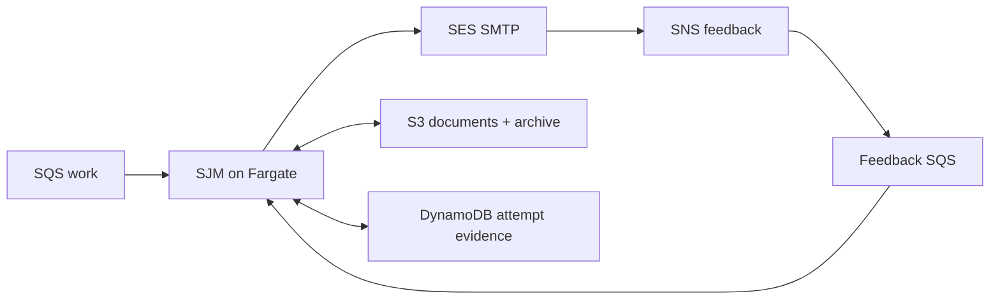

## Start here

Download and extract the [complete Simple Java Mail sources](https://github.com/bbottema/simple-java-mail/archive/refs/heads/codex/10.0.0.zip), or use your existing [matching source checkout](https://github.com/bbottema/simple-java-mail/tree/codex/10.0.0). Open a terminal in the directory containing `pom.xml` and `tools/`.

You'll need Docker Engine or Docker Desktop with Linux containers and Compose 2.24.4 or newer. Set aside several GB of disk space and at least 4 GB of Docker memory, with more room for brokers and workflow engines. Docker runs the JDK, Maven and test mail server for you, so you don't need to install them or connect a real mail account.

Run these commands from that directory:

```text
docker compose -f tools/integration-patterns/aws-correspondence/compose.yaml up --build -d --wait
docker compose -f tools/integration-patterns/aws-correspondence/compose.yaml run --rm scenario
```

Open [the job records](http://localhost:8787/jobs). Repeating the input should produce just one submission. Rejected attempts and sends with an uncertain result stay on hold for review, while delivery feedback is recorded separately.

Docker builds the matching source and runs ElasticMQ, DynamoDB Local, S3Mock and a TLS SMTP test server, so you don't need a host JDK, Maven or cloud account. The scenario supplies SES JSON to test how the application handles it. These substitutes let you try the application locally, but they don't reproduce AWS or prove SES compatibility.

## Follow one job

Begin at [`CorrespondenceWorker.deliver`](https://github.com/bbottema/simple-java-mail/blob/codex/10.0.0/tools/integration-patterns/aws-correspondence/src/main/java/org/simplejavamail/examples/aws/CorrespondenceWorker.java). Follow the job claim into `prepareArchiveAndSubmit`, then `recordOutcome` to see how it saves the SMTP result. Next, read `recordFeedback` for the SES JSON that arrives later. Those events refer to the same job, but they are processed separately from the original send and database transaction. Try this locally before moving on to the Terraform or CloudFormation templates.

In `/jobs`, check that the attempt with a lost reply stays on hold and that a late delay report doesn't overwrite an already recorded delivery. Once you've tried those checks locally, the separate AWS deployment below lets you explore the same flow with billable cloud resources.

## The problem

You need to send protected documents to partners, keep a record of what was submitted and handle delivery feedback later. SQS can carry the work, but it can't guarantee exactly-once email. Your application still needs to prepare each message and decide what to do with uncertain results or later feedback.

## Where SJM fits

Each SQS job points to a document in S3. A long-running Fargate worker claims the job in DynamoDB, uses SJM to sign and encrypt the mail, saves the finalized message and submits it through SES SMTP. Reusing the Mailer lets the worker keep its connection pool between jobs.



SJM prepares the MIME message, applies the configured protection and submits it over SMTP. AWS provides the queue, storage, conditional database updates and mail service. Your application decides who may send, prevents repeated input from sending twice and checks attempts whose outcome is unclear.

You can run the worker without a public HTTP endpoint, load balancer, workflow engine or inbound SES receiving service. Its certificate is synthetic, so real partner correspondence will need a separate way to manage identities and trust.

## SES feedback

A dedicated SES configuration set sends events through SNS to the feedback queue. The worker uses application attempt tags to match each event to a stored job and recipient, since you can't assume SES will preserve the application's Message-ID.

The worker reads SES JSON and keeps the feedback even when events are duplicated or arrive out of order. If you're receiving actual notification emails instead, see [Reading delivery reports](/delivery-reports.html) for parsing those MIME reports.

TLS between your worker and SES only covers that connection; SES has a separate policy for onward delivery. S/MIME protects the message content, but an SMTP response or delivery event still won't tell you whether a person read or decrypted it.

The scenario repeats input, compares protected archive hashes and supplies duplicate feedback in different orders. It holds rejected or uncertain submissions for review and sends feedback it can't match to a dead-letter queue. All synthetic mail stays in the test server.

## Identify the application to SES

The worker sets `ConnectionConfig.Builder.withSmtpClientHostname("correspondence.example.test")` because a container's generated hostname may not be useful to the mail server. For a real deployment, choose your approved client hostname. This sets EHLO/HELO without changing the sender, SES endpoint or TLS certificate checks, and the demo script doesn't need to change DNS.

## AWS deployment

You can deploy with either Terraform or CloudFormation using the shared runner. Both versions use the same worker configuration and pin the application to an ECR image digest.

Supply a profile, expected account, region, unique run name, existing verified SES domain and sender. Run `preflight` to check those inputs and `plan` to validate without creating resources. The `deploy`, `scenario`, `status` and `destroy` commands then use the saved details for that run.

The deployment creates a network, a task security group with no inbound access, an ECR repository, queues and dead-letter queues, a bucket, a table, a configuration set, a feedback subscription, logs and scoped roles. Demo SMTP credentials go into Secrets Manager, outside the templates and state files, rather than into an image or download.

The scripts leave your existing sending identity and its settings alone, including DNS, identity defaults, suppression settings and production feedback routes. Use only one deployment format for each run, and create separate resources rather than trying to adopt infrastructure you already have.

The cloud scenarios send to SES mailbox simulator addresses to check submission, feedback and archive storage. They don't test partner decryption. The dated verification record lists what was deployed, observed and cleaned up. AWS resources cost money, and a successful local run doesn't verify the cloud's IAM or network setup.

For example, when SES accepts a message and later reports a simulated bounce, the job records both results:

```json
{"case":"bounce","smtp":"ACCEPTED","feedback":["Bounce","Send"],"archiveHashMatches":true}
```

The later bounce does not rewrite the earlier submission result or authorize an automatic resend.

If connection cleanup fails after SMTP acceptance, the inline result observer keeps that acceptance result and holds the operation for inspection. If saving the result itself fails, the job stays `SENDING` so you can check what happened before retrying.

## Source and cleanup

[Download the sources and cloud scripts](/assets/guides/integration-patterns/strategic-patterns.zip). The [AWS source README](https://github.com/bbottema/simple-java-mail/tree/codex/10.0.0/tools/integration-patterns/aws-correspondence) has the full commands, prerequisites and checks that keep changes specific to your deployment.

```text
docker compose -f tools/integration-patterns/aws-correspondence/compose.yaml down --volumes --remove-orphans
```

To remove cloud resources, run `destroy` with the same arguments and saved run manifest. Before deleting bucket contents or images, the script checks the recorded resource identities and ownership tags, rather than relying on names alone. It also checks that the sending identity is unchanged. Keep cleanup specific to this run so it doesn't affect unrelated resources.
