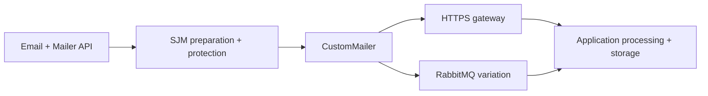

## Start here

Download and extract the [complete Simple Java Mail sources](https://github.com/bbottema/simple-java-mail/archive/refs/heads/codex/10.0.0.zip), or use your existing [matching source checkout](https://github.com/bbottema/simple-java-mail/tree/codex/10.0.0). Open a terminal in the directory containing `pom.xml` and `tools/`.

You'll need Docker Engine or Docker Desktop with Linux containers and Compose 2.24.4 or newer. Set aside several GB of disk space and at least 4 GB of Docker memory, with more room for brokers and workflow engines. Docker runs the JDK, Maven and test mail server for you, so you don't need to install them or connect a real mail account.

Run these commands from that directory:

```text
docker compose -f tools/integration-patterns/custom-handoff/compose.yaml up --build -d --wait
docker compose -f tools/integration-patterns/custom-handoff/compose.yaml run --rm scenario
```

Open [the handoff results](http://localhost:8787/jobs). A successful job is `HANDED_OFF`; a rejected package or lost confirmation is `HELD`. The scenario also verifies/decrypts the stored package inside Docker. No SMTP server runs in this stack.

## Follow one job

Start at [`HandoffApplication.submit`](https://github.com/bbottema/simple-java-mail/blob/codex/10.0.0/tools/integration-patterns/custom-handoff/src/main/java/org/simplejavamail/examples/handoff/HandoffApplication.java). Its normal Mailer call reaches `HandoffTransport.sendMessage`, which packages the prepared MIME in [`HandoffPackage`](https://github.com/bbottema/simple-java-mail/blob/codex/10.0.0/tools/integration-patterns/custom-handoff/src/main/java/org/simplejavamail/examples/handoff/HandoffPackage.java). Follow it into [`HandoffReceiver`](https://github.com/bbottema/simple-java-mail/blob/codex/10.0.0/tools/integration-patterns/custom-handoff/src/main/java/org/simplejavamail/examples/handoff/HandoffReceiver.java) for verification and storage. Read the HTTPS or RabbitMQ mechanics last; neither changes the role of SJM's preparation.

Compare a successful package with one stored by the receiver whose HTTPS confirmation was lost. The second job stays on hold because the sender can't tell whether it arrived. Even a successful callback reports `UNKNOWN` for SMTP acceptance, since there's no SMTP server in this example. Once you've checked that, try the broker version.

## The problem

You need to prepare a signed or encrypted email, but the receiving system expects an HTTPS request, broker message or file. You'd like to keep SJM's MIME and protection work while changing how the result gets there.

## Non-SMTP handoff

Use the normal Email and Mailer APIs to prepare the message. SJM runs the applicable policy checks, validation, MIME preparation and protection before calling `CustomMailer`. Your callback then packages that prepared message and sends it to the HTTPS gateway.



The example doesn't start or configure an SMTP server. The receiver can store or process the package without ever sending email, so you need to define what its acceptance means and what happens afterwards.

## Protected packages

Send the prepared MIME bytes alongside the separate envelope data, including hidden recipients. Keep Email, Mailer, configuration and private-key objects out of the package. If you rebuild MIME from parsed fields, you can change the bytes and break the protection you're trying to preserve.

The receiver decrypts the synthetic partner message, verifies its signature and stores an encrypted copy. Its development certificate and archive key let you try those steps locally. You'll need your own way to establish trust and manage keys for real partners.

## Choose the destination

Start with the HTTPS version, which checks the server's certificate and hostname. The RabbitMQ version publishes persistent messages with confirmation, then processes them in a separate consumer. You could use the same callback for storage or SFTP, though those implementations aren't included.

An HTTPS response tells you the gateway accepted the package, while a broker confirmation tells you it was published. Neither proves that a consumer finished processing it or that an SMTP server accepted any mail. SJM therefore reports `UNKNOWN` for SMTP acceptance. If the handoff fails ambiguously, leave it on hold and check the receiver's records and duplicate-handling rules before retrying.

The demo gateway rejects requests for DSNs, onward TLS or recipient-rejection behavior because it doesn't implement them. When building your own integration, decide how each requested feature maps to the destination and reject any you can't support.

The scenario checks protection, hidden-envelope recipients, duplicate requests, rejected packages and stored packages whose confirmation was lost:

```json
{"pattern":"custom-handoff","mode":"https","smtpServer":false,"preparedProtectionVerified":true,"duplicateSuppressed":true,"smtpAcceptance":"UNKNOWN"}
```

For the broker variation, stop HTTPS first and keep both files on each command. Publication and consumer evidence remain separate.

```text
docker compose -f tools/integration-patterns/custom-handoff/compose.yaml down --volumes --remove-orphans
docker compose -f tools/integration-patterns/custom-handoff/compose.yaml -f tools/integration-patterns/custom-handoff/rabbitmq.yaml up --build -d --wait
docker compose -f tools/integration-patterns/custom-handoff/compose.yaml -f tools/integration-patterns/custom-handoff/rabbitmq.yaml run --rm scenario
```

## Source and cleanup

[Download the examples](/assets/guides/integration-patterns/strategic-patterns.zip). The [source README](https://github.com/bbottema/simple-java-mail/tree/codex/10.0.0/tools/integration-patterns/custom-handoff) describes the gateway contract; the [workbench notes](https://github.com/bbottema/simple-java-mail/tree/codex/10.0.0/tools/integration-patterns) describe resources and verification. You implement the handoff in your application with CustomMailer.

```text
docker compose -f tools/integration-patterns/custom-handoff/compose.yaml down --volumes --remove-orphans
```

Everything is synthetic and project-scoped. Omit `--volumes` to retain evidence; do not prune unrelated resources.

If you used RabbitMQ, include its file on cleanup:

```text
docker compose -f tools/integration-patterns/custom-handoff/compose.yaml -f tools/integration-patterns/custom-handoff/rabbitmq.yaml down --volumes --remove-orphans
```
