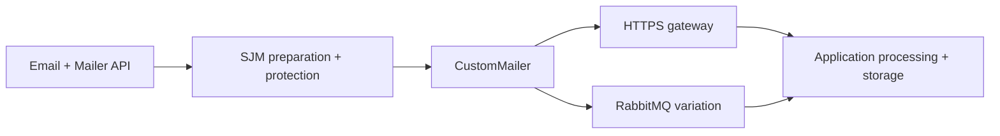

## Start here

Download and extract the [complete Simple Java Mail sources](https://github.com/bbottema/simple-java-mail/archive/refs/heads/codex/10.0.0.zip), or use your existing [matching source checkout](https://github.com/bbottema/simple-java-mail/tree/codex/10.0.0). Open a terminal in the directory containing `pom.xml` and `tools/`.

Use Docker Engine/Desktop with Linux containers and Compose 2.24.4 or newer. Allow several GB of disk space and at least 4 GB of Docker memory; brokers and workflow engines may need more. No host JDK, Maven or real mail account is needed.

Run these commands from that directory:

```text
docker compose -f tools/integration-patterns/custom-handoff/compose.yaml up --build -d --wait
docker compose -f tools/integration-patterns/custom-handoff/compose.yaml run --rm scenario
```

Open [the handoff results](http://localhost:8787/jobs). A successful job is `HANDED_OFF`; a rejected package or lost confirmation is `HELD`. The scenario also verifies/decrypts the stored package inside Docker. No SMTP server runs in this stack.

## Follow one job

Start at [`HandoffApplication.submit`](https://github.com/bbottema/simple-java-mail/blob/codex/10.0.0/tools/integration-patterns/custom-handoff/src/main/java/org/simplejavamail/examples/handoff/HandoffApplication.java). Its normal Mailer call reaches `HandoffTransport.sendMessage`, which packages the prepared MIME in [`HandoffPackage`](https://github.com/bbottema/simple-java-mail/blob/codex/10.0.0/tools/integration-patterns/custom-handoff/src/main/java/org/simplejavamail/examples/handoff/HandoffPackage.java). Follow it into [`HandoffReceiver`](https://github.com/bbottema/simple-java-mail/blob/codex/10.0.0/tools/integration-patterns/custom-handoff/src/main/java/org/simplejavamail/examples/handoff/HandoffReceiver.java) for verification and storage. Read the HTTPS or RabbitMQ mechanics last; neither changes the role of SJM's preparation.

Compare the successful package with the stored package whose HTTPS confirmation was lost. The latter stays held. `UNKNOWN` SMTP acceptance on a successful callback is honest here: there is no SMTP server. Then try the broker variation.

## The problem

Your application needs an email-shaped, protected communication, but its destination accepts a REST request, event or file instead of SMTP. Replacing that final step should not require rebuilding MIME and cryptographic processing.

## Non-SMTP handoff

Keep the ordinary Email/Mailer API. SJM applies applicable governance, validation, MIME preparation and protection, then invokes `CustomMailer` with the prepared message. The callback sends an application-defined package to an HTTPS gateway.



No SMTP server is configured or started. The destination may process or retain the package without ever sending email. Those acceptance and processing contracts belong to the application.

## Protected packages

Serialize the prepared MIME and carry its separate envelope, including hidden recipients, alongside it. Do not serialize Email, Mailer, configuration or private-key objects. Rebuilding MIME from parsed getters would undermine protection and exact-byte contracts.

The receiving application decrypts/verifies the synthetic partner message and stores an encrypted copy. Its development certificate and archive key demonstrate mechanics, not production trust.

## Choose the destination

The primary destination is HTTPS with certificate/hostname verification. The RabbitMQ variation uses confirmed persistent publication and an independent consumer. Storage or SFTP can use the same callback boundary; those additional implementations are not included here.

Gateway acceptance is not SMTP acceptance. Broker confirmation is not consumer completion. SJM reports `UNKNOWN` SMTP acceptance because it cannot inspect an external service's sending behavior. Ambiguous handoff failures are held; inspect evidence and use the destination's explicit idempotency contract before retrying.

This gateway rejects requested DSN, onward TLS and recipient-rejection semantics instead of pretending it implements them. A real integration must map each supported requirement or reject it clearly.

The scenario checks protection, hidden-envelope recipients, duplicate requests, rejected packages and stored packages whose confirmation was lost:

```json
{"pattern":"custom-handoff","mode":"https","smtpServer":false,"preparedProtectionVerified":true,"duplicateSuppressed":true,"smtpAcceptance":"UNKNOWN"}
```

For the broker variation, stop HTTPS first and keep both files on each command. Publication and consumer evidence remain separate.

```text
docker compose -f tools/integration-patterns/custom-handoff/compose.yaml down --volumes --remove-orphans
docker compose -f tools/integration-patterns/custom-handoff/compose.yaml -f tools/integration-patterns/custom-handoff/rabbitmq.yaml up --build -d --wait
docker compose -f tools/integration-patterns/custom-handoff/compose.yaml -f tools/integration-patterns/custom-handoff/rabbitmq.yaml run --rm scenario
```

## Source and cleanup

[Download the examples](/assets/guides/integration-patterns/strategic-patterns.zip). The [source README](https://github.com/bbottema/simple-java-mail/tree/codex/10.0.0/tools/integration-patterns/custom-handoff) describes the gateway contract; the [workbench notes](https://github.com/bbottema/simple-java-mail/tree/codex/10.0.0/tools/integration-patterns) describe resources and verification. This is application integration, not another SJM transport SPI.

```text
docker compose -f tools/integration-patterns/custom-handoff/compose.yaml down --volumes --remove-orphans
```

Everything is synthetic and project-scoped. Omit `--volumes` to retain evidence; do not prune unrelated resources.

If you used RabbitMQ, include its file on cleanup:

```text
docker compose -f tools/integration-patterns/custom-handoff/compose.yaml -f tools/integration-patterns/custom-handoff/rabbitmq.yaml down --volumes --remove-orphans
```
