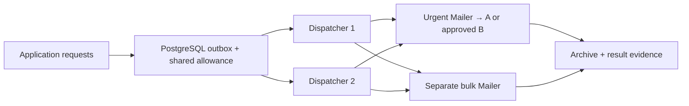

## Start here

Download and extract the [complete Simple Java Mail sources](https://github.com/bbottema/simple-java-mail/archive/refs/heads/codex/10.0.0.zip), or use your existing [matching source checkout](https://github.com/bbottema/simple-java-mail/tree/codex/10.0.0). Open a terminal in the directory containing `pom.xml` and `tools/`.

You'll need Docker Engine or Docker Desktop with Linux containers and Compose 2.24.4 or newer. Set aside several GB of disk space and at least 4 GB of Docker memory, with more room for brokers and workflow engines. Docker runs the JDK, Maven and test mail server for you, so you don't need to install them or connect a real mail account.

Run these commands from that directory:

```text
docker compose -f tools/integration-patterns/polar-meridian/compose.yaml up --build -d --wait
docker compose -f tools/integration-patterns/polar-meridian/compose.yaml run --rm scenario
```

Open [the jobs](http://localhost:8787/jobs), [attempts](http://localhost:8787/attempts), [limits](http://localhost:8787/limits) and [events](http://localhost:8787/events) to see what the application recorded. These endpoints are only for inspecting the local demo. Its test SMTP servers keep all mail locally, and the scenario supplies synthetic delivery notifications.

Expect urgent work to finish while bulk work waits. You should also see the approved relay switch from A to B and back to A, matching bytes in the protected archive, and an event asking for attention when the scenario makes a result write fail.

## Follow one job

Start at [`PolarMeridianApplication`](https://github.com/bbottema/simple-java-mail/blob/codex/10.0.0/tools/integration-patterns/polar-meridian/src/main/java/PolarMeridianApplication.java), where the constructor connects the article's Dispatcher to the demo's storage and sending code. Follow [`PolarStorage`](https://github.com/bbottema/simple-java-mail/blob/codex/10.0.0/tools/integration-patterns/polar-meridian/src/main/java/PolarStorage.java) into the [original Dispatcher](/assets/journal/articles/polar-meridian/examples/PolarMeridianDispatcher.java), then return to `preparation` and `recordOutcome` to see how a message is prepared and its result saved. The [JDBC limiter](/assets/journal/articles/polar-meridian/examples/JdbcDispatchLimits.java) checks the allowance shared by both instances, while SJM's local limit applies within each factory.

Compare `/jobs`, `/attempts` and `/events` after the scenario. Check that the protected job's archived bytes match the captured message, and look for the event raised when saving a result fails. If you want to explore telemetry too, try the optional Collector setup below.

## The problem

Several applications share a company's sending infrastructure. Login codes, confirmations and campaigns cannot all consume the same resources without coordination.

The [Polar Meridian case study](/case-studies/polar-meridian.html) explains the design. This example uses its [existing Dispatcher helpers](/assets/journal/articles/polar-meridian/examples/README.md) unchanged, adding a database and archive storage so you can run it yourself. It doesn't reproduce the fictional company's throughput or provide a production mail platform.



## Urgent mail under bulk load

Two dispatchers share PostgreSQL, with separate polling and Mailers for urgent, routine and bulk work. The scenario queues a bulk backlog and blocks its shared sending allowance, then checks that an urgent job can still finish.

SJM manages the local workers and SMTP connections. Your application decides which jobs can run and how to divide the allowance shared by both instances.

## Shared sending limits

Before admitting work, the article's JDBC limiter locks the database row for that workload and charges the send against its allowance. Both instances check the same record, so one class of mail can't use another's allocation. Switching to a backup relay doesn't give a job a fresh allowance either.

SJM's own sending rules apply within a MailerFactory, so they don't replace this shared check. The demo allocations are made up for testing; you'll need to choose limits that fit your provider and workload.

## Protected archive

For confidential correspondence, the application uses S/MIME, stores an encrypted archive and submits the finalized EML through the exact-message API. The scenario decrypts urgent and bulk messages, verifies their protection and compares the captured bytes with the copies in the archive.

The Mailers use TLS settings locked by the article's factory configuration. The archive key and generated certificate are public development fixtures. For real correspondence, you'll need to establish partner trust, manage keys securely and decide what your archive must retain.

## Failover and recovery

The scenario disconnects urgent relay A and makes new connections to it fail. Untouched work can then go to the approved backup B. After A's reconsideration interval, later jobs use A again.

Waiting for a worker or a sending allowance doesn't trigger failover. Once submission to the provider begins, SJM won't use connection failover to resend that message. If only some recipients were accepted, or the result is uncertain, your application needs to decide what to do.

## Observation failures

Try making the archive-result write fail and look for the event asking for attention. The mail may have been accepted even though saving the result failed, so a missing record isn't enough reason to send it again.

When a dispatcher claims a job, it stores a token that identifies the claim. If that process disappears before recording a result, the job stays unavailable for automatic retry. Check the submission records before deciding how to recover it.

## OpenTelemetry

Add the optional Collector file to startup, scenario and cleanup:

```text
docker compose -f tools/integration-patterns/polar-meridian/compose.yaml -f tools/integration-patterns/polar-meridian/observability.yaml up --build -d --wait
docker compose -f tools/integration-patterns/polar-meridian/compose.yaml -f tools/integration-patterns/polar-meridian/observability.yaml run --rm scenario
```

You can read Collector traces with `logs collector` and view metrics at `http://localhost:8789/metrics`. The application creates the SDK and exporters and closes them after the Mailers. It keeps message IDs and recipients out of metric labels.

## Source and cleanup

[Download the examples](/assets/guides/integration-patterns/strategic-patterns.zip). See the [source README](https://github.com/bbottema/simple-java-mail/tree/codex/10.0.0/tools/integration-patterns/polar-meridian) and [workbench notes](https://github.com/bbottema/simple-java-mail/tree/codex/10.0.0/tools/integration-patterns) for resource and verification limits.

```text
docker compose -f tools/integration-patterns/polar-meridian/compose.yaml down --volumes --remove-orphans
```

Include the observability file when cleaning that variation. Remove only this project's data, never unrelated Docker resources.

```text
docker compose -f tools/integration-patterns/polar-meridian/compose.yaml -f tools/integration-patterns/polar-meridian/observability.yaml down --volumes --remove-orphans
```
