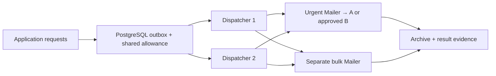

## Start here

Download and extract the [complete Simple Java Mail sources](https://github.com/bbottema/simple-java-mail/archive/refs/heads/codex/10.0.0.zip), or use your existing [matching source checkout](https://github.com/bbottema/simple-java-mail/tree/codex/10.0.0). Open a terminal in the directory containing `pom.xml` and `tools/`.

Use Docker Engine/Desktop with Linux containers and Compose 2.24.4 or newer. Allow several GB of disk space and at least 4 GB of Docker memory; brokers and workflow engines may need more. No host JDK, Maven or real mail account is needed.

Run these commands from that directory:

```text
docker compose -f tools/integration-patterns/polar-meridian/compose.yaml up --build -d --wait
docker compose -f tools/integration-patterns/polar-meridian/compose.yaml run --rm scenario
```

Inspect `http://localhost:8787/jobs`, `/attempts`, `/limits` and `/events`. These synthetic loopback-only endpoints are not a public management API. The SMTP fixtures never forward mail; injected notifications are not Internet-delivery evidence.

Expect urgent work to complete while bulk work waits, approved A→B→A recovery, matching protected archive bytes and an attention event for the injected result-write failure.

## Follow one job

Start at [`PolarMeridianApplication`](https://github.com/bbottema/simple-java-mail/blob/codex/10.0.0/tools/integration-patterns/polar-meridian/src/main/java/PolarMeridianApplication.java), where the constructor connects the original Dispatcher to application adapters. Follow [`PolarStorage`](https://github.com/bbottema/simple-java-mail/blob/codex/10.0.0/tools/integration-patterns/polar-meridian/src/main/java/PolarStorage.java) into the [original Dispatcher](/assets/journal/articles/polar-meridian/examples/PolarMeridianDispatcher.java), then return to `preparation` and `recordOutcome`. The [JDBC limiter](/assets/journal/articles/polar-meridian/examples/JdbcDispatchLimits.java) owns the shared application allowance; SJM's local sending limit has a different scope.

Compare `/jobs`, `/attempts` and `/events` after the scenario. The protected job should have matching archive evidence, while an injected result-write failure produces an attention event. Optional Collector output is a separate exploration below.

## The problem

Several applications share a company's sending infrastructure. Login codes, confirmations and campaigns cannot all consume the same resources without coordination.

The [Polar Meridian case study](/case-studies/polar-meridian.html) explains the design. This executable slice compiles its [existing Dispatcher helpers](/assets/journal/articles/polar-meridian/examples/README.md) unchanged and supplies database/archive adapters. It does not reproduce the fictional company's throughput or provide a production mail platform.



## Urgent mail under bulk load

Two dispatcher instances share PostgreSQL. Assigned urgent, routine and bulk classes have separate polls and Mailers. The scenario queues a bulk backlog while its application allowance is held, then verifies an urgent job can complete.

SJM controls local execution and SMTP resources. The application decides which work is permitted and how shared allowance is divided.

## Shared sending limits

The article's JDBC limiter locks and charges a workload row before admission. Both instances consult that ledger. One class cannot spend another's allocation; failover does not create fresh application allowance.

This is distinct from SJM's factory-local sending rules. The example uses fictional test allocations, not discovered provider quotas or a throughput recommendation.

## Protected archive

The application prepares confidential correspondence with S/MIME, stores encrypted archive data and submits the finalized EML through the exact-message API. The scenario decrypts/verifies protected urgent and bulk messages, comparing their captured bytes with the retained representations.

The approved Mailers use the article's factory-locked TLS configuration. The archive key and generated certificate are public development fixtures, not trusted partner identity, production key management or a legal-retention guarantee.

## Failover and recovery

The scenario disconnects urgent relay A and refuses new setup there. Approved B can accept untouched work. After A's reconsideration interval, later work returns to A.

Normal queue/rate waiting does not trigger failover. Once provider submission begins, connection failover cannot replay that email. Partial or uncertain results need an application decision.

## Observation failures

Inject a failed archive-result write and inspect its attention event. SMTP success does not make a failed evidence write successful; missing evidence is not permission to resend.

Claims carry ownership tokens. Unresolved claims remain unavailable for automatic replay, including when their original process disappears. Recovery must reconcile them with submission evidence.

## OpenTelemetry

Add the optional Collector file to startup, scenario and cleanup:

```text
docker compose -f tools/integration-patterns/polar-meridian/compose.yaml -f tools/integration-patterns/polar-meridian/observability.yaml up --build -d --wait
docker compose -f tools/integration-patterns/polar-meridian/compose.yaml -f tools/integration-patterns/polar-meridian/observability.yaml run --rm scenario
```

Inspect Collector traces with `logs collector` and metrics at `http://localhost:8789/metrics`. The application owns the SDK/exporters and closes them after the Mailers. Per-message IDs and recipients are not metric labels.

## Source and cleanup

[Download the examples](/assets/guides/integration-patterns/strategic-patterns.zip). See the [source README](https://github.com/bbottema/simple-java-mail/tree/codex/10.0.0/tools/integration-patterns/polar-meridian) and [workbench notes](https://github.com/bbottema/simple-java-mail/tree/codex/10.0.0/tools/integration-patterns) for resource and verification limits.

```text
docker compose -f tools/integration-patterns/polar-meridian/compose.yaml down --volumes --remove-orphans
```

Include the observability file when cleaning that variation. Remove only this project's data, never unrelated Docker resources.

```text
docker compose -f tools/integration-patterns/polar-meridian/compose.yaml -f tools/integration-patterns/polar-meridian/observability.yaml down --volumes --remove-orphans
```
