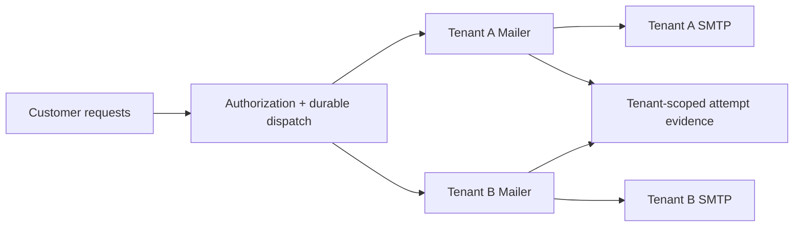

## Start here

Download and extract the [complete Simple Java Mail sources](https://github.com/bbottema/simple-java-mail/archive/refs/heads/codex/10.0.0.zip), or use your existing [matching source checkout](https://github.com/bbottema/simple-java-mail/tree/codex/10.0.0). Open a terminal in the directory containing `pom.xml` and `tools/`.

Use Docker Engine/Desktop with Linux containers and Compose 2.24.4 or newer. Allow several GB of disk space and at least 4 GB of Docker memory; brokers and workflow engines may need more. No host JDK, Maven or real mail account is needed.

Run these commands from that directory:

```text
docker compose -f tools/integration-patterns/relaydesk/compose.yaml up --build -d --wait
docker compose -f tools/integration-patterns/relaydesk/compose.yaml run --rm scenario
```

Tenant evidence at `http://localhost:8787/jobs` needs its demo token. Use the HTTP client already inside the application container to include A's token:

```text
docker compose -f tools/integration-patterns/relaydesk/compose.yaml exec app curl --silent -H "X-Demo-Tenant-Token: tenant-a-local" http://localhost:8080/jobs
```

The fixtures capture synthetic `.test` messages and have no forwarding implementation. TLS uses a development certificate trusted only inside the example images, never in your computer's trust store.

Expect ordinary jobs to reach `SUBMITTED`, with partial or uncertain attempts held. A failed credential replacement pauses only A; B should still complete.

## Follow one job

Begin at [`RelayDeskApplication.enqueue`](https://github.com/bbottema/simple-java-mail/blob/codex/10.0.0/tools/integration-patterns/relaydesk/src/main/java/RelayDeskApplication.java), then follow `dispatchNext`, `submit` and `recordOutcome` in that file. Read `TenantRoute.replace` next: it pauses one customer while replacing that customer's Mailer. The [original article helpers](/assets/journal/articles/relaydesk/examples/RelayDeskMailExamples.java) remain unchanged; this application gives those helpers a concrete database and tenant boundary.

Inspect A's job evidence after the scenario. A bad password replacement should leave only A paused while B still completes; a later valid replacement resumes A. The command uses development tokens, not production authentication.

## The problem

A support platform sends on behalf of several customers. Their servers, credentials and limits differ. A stalled customer must not block another, and replacing a password must not strand admitted work.

The [RelayDesk case study](/case-studies/relaydesk.html) tells the story. Its [original helpers](/assets/journal/articles/relaydesk/examples/README.md) remain useful independently. This Docker application is an additional exploration path, not a replacement for the article or a production multi-tenant service.



## Tenant isolation

The registry supplies approved hosts, credentials and sender defaults. Requests cannot choose arbitrary SMTP settings. A synthetic tenant token cannot select another tenant's route or inspect its jobs.

PostgreSQL records the attempt before the unchanged article helper submits it. The result observer updates its evidence. The scenario holds tenant A at a server barrier and proves tenant B can complete independently.

The public development tokens make this test inspectable. Production authentication, destination approval, DNS/egress restrictions and authorization remain application responsibilities.

## Fair turns and route replacement

Separate bounded execution and local sending limits prevent one tenant from consuming another's workers. These are not distributed provider quotas.

Password replacement pauses the affected tenant, drains admitted sends, closes the old Mailer, constructs and probes its replacement, then resumes. An unsuccessful check leaves the route paused. Other tenants continue.

The finite registry and replacement scenario do not establish that unlimited customer churn is safe. A real platform needs its own registry capacity and retirement policy.

## Inspect the evidence

The scenario checks tenant boundaries, independent progress, duplicate input, credential replacement and partial/uncertain results. An unsuccessful
credential check pauses only that tenant; a valid replacement resumes its work. Injected delivery-report correlation cannot cross tenant boundaries.
Abbreviated output:

```json
{"pattern":"relaydesk","tenantIsolation":true,"fairTurns":true,"credentialRevision":3,"oldRouteRetired":true,"partialAndUnknownHeld":true}
```

This is application evidence. SMTP acceptance is not final delivery. Partial or uncertain attempts are held; missing result evidence also needs reconciliation, not blind replay.

## Source and cleanup

[Download the examples](/assets/guides/integration-patterns/strategic-patterns.zip). The [source README](https://github.com/bbottema/simple-java-mail/tree/codex/10.0.0/tools/integration-patterns/relaydesk) records endpoints and ownership. The [workbench notes](https://github.com/bbottema/simple-java-mail/tree/codex/10.0.0/tools/integration-patterns) cover resource, image, licensing and verification boundaries.

```text
docker compose -f tools/integration-patterns/relaydesk/compose.yaml down --volumes --remove-orphans
```

Omit `--volumes` to retain this project's development data. Never use a global Docker prune.
