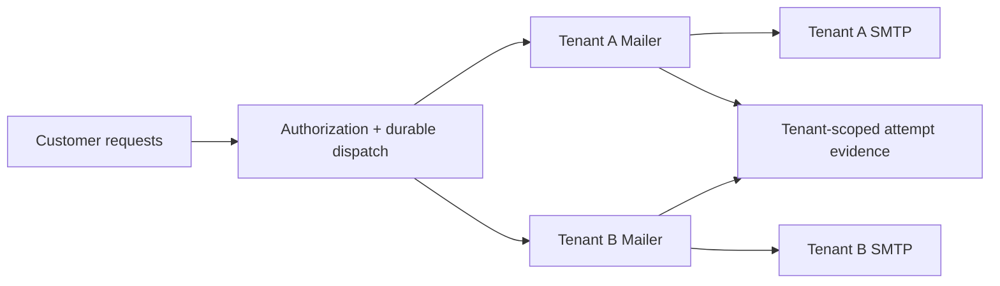

## Start here

Download and extract the [complete Simple Java Mail sources](https://github.com/bbottema/simple-java-mail/archive/refs/heads/codex/10.0.0.zip), or use your existing [matching source checkout](https://github.com/bbottema/simple-java-mail/tree/codex/10.0.0). Open a terminal in the directory containing `pom.xml` and `tools/`.

You'll need Docker Engine or Docker Desktop with Linux containers and Compose 2.24.4 or newer. Set aside several GB of disk space and at least 4 GB of Docker memory, with more room for brokers and workflow engines. Docker runs the JDK, Maven and the services for each demo. The local examples use synthetic data and run without a real mail account.

Run these commands from that directory:

```text
docker compose -f tools/integration-patterns/relaydesk/compose.yaml up --build -d --wait
docker compose -f tools/integration-patterns/relaydesk/compose.yaml run --rm scenario
```

The jobs endpoint at `http://localhost:8787/jobs` needs a demo token to show a customer's records. Use the HTTP client inside the application container to ask for customer A's jobs:

```text
docker compose -f tools/integration-patterns/relaydesk/compose.yaml exec app curl --silent -H "X-Demo-Tenant-Token: tenant-a-local" http://localhost:8080/jobs
```

The fixtures capture synthetic `.test` messages and have no forwarding implementation. TLS uses a development certificate trusted only inside the example images, never in your computer's trust store.

Expect ordinary jobs to reach `SUBMITTED`, with partial or uncertain attempts held. A failed credential replacement pauses only A; B should still complete.

## Follow one job

Begin at [`RelayDeskApplication.enqueue`](https://github.com/bbottema/simple-java-mail/blob/codex/10.0.0/tools/integration-patterns/relaydesk/src/main/java/RelayDeskApplication.java), then follow `dispatchNext`, `submit` and `recordOutcome` in the same file. Next, read `TenantRoute.replace` to see how it pauses one customer while replacing their Mailer. The application uses the [original article helpers](/assets/journal/articles/relaydesk/examples/RelayDeskMailExamples.java) unchanged, adding a database and separate routes for each customer.

Look at A's jobs after the scenario. A bad replacement password should pause A while B keeps sending; a valid password lets A resume. These tokens are just for the demo, so you'll need real authentication in your own service.

## The problem

Your support platform sends mail through each customer's own server. When one server stalls, the other customers still need to send. You also need to replace credentials without losing work that's already been accepted for sending.

The [RelayDesk case study](/case-studies/relaydesk.html) explains that setup, and you can use its [original helpers](/assets/journal/articles/relaydesk/examples/README.md) on their own. This Docker application gives you a way to try the ideas with a database and test servers, though it isn't a production service for multiple customers.



## Tenant isolation

Each customer's approved host, credentials and sender defaults come from a registry, so a request can't choose arbitrary SMTP settings. The demo uses a separate token per customer to keep requests on their own route and prevent access to another customer's jobs.

Before the article helper sends a message, the application records the attempt in PostgreSQL. A result observer then saves the outcome. To check that customers can make progress independently, the scenario stalls customer A at its server while customer B completes a send.

You can use the public development tokens to inspect the demo. For a real service, you'll need authentication and authorization, a way to approve destinations, and restrictions on DNS resolution and outgoing connections.

## Fair turns and route replacement

Each customer gets separate workers and local sending limits, so one can't use up another's workers. If you also need to enforce a provider quota across several application instances, you'll need a shared limit.

1. **Pause that customer’s route.** Let its in-flight sends finish.
2. **Replace the Mailer.** Close the old Mailer, then build and check the replacement.
3. **Resume on success.** If the check fails, keep that customer paused while the others continue.

This demo replaces credentials for a fixed set of customers. If your service continually adds and removes customers, you'll also need to limit registry size and retire routes that are no longer used.

## Inspect the evidence

Look for `failedReplacementPausedOnlyItsTenant` in the scenario output. After a bad password replacement, A stays paused while B’s job reaches `SUBMITTED`. A resumes after a valid replacement is checked.

```json
{"failedReplacementPausedOnlyItsTenant":true,"partialAndUnknownHeld":true}
```

- **Isolation.** Each customer can send while the other is stalled. Cross-customer access to jobs and reports is rejected. The scenario also checks duplicate input.
- **Submission evidence.** Partial or uncertain SMTP outcomes stay on hold. If saving a result fails, check what the relay accepted before deciding to resend. Final delivery depends on later feedback.

## Source and cleanup

[Download the examples](/assets/guides/integration-patterns/strategic-patterns.zip). The [source README](https://github.com/bbottema/simple-java-mail/tree/codex/10.0.0/tools/integration-patterns/relaydesk) lists the endpoints and explains how customer access is checked. The [workbench notes](https://github.com/bbottema/simple-java-mail/tree/codex/10.0.0/tools/integration-patterns) cover resource requirements, container images, licensing and what has been tested.

```text
docker compose -f tools/integration-patterns/relaydesk/compose.yaml down --volumes --remove-orphans
```

Omit `--volumes` to retain this project's development data. Never use a global Docker prune.
